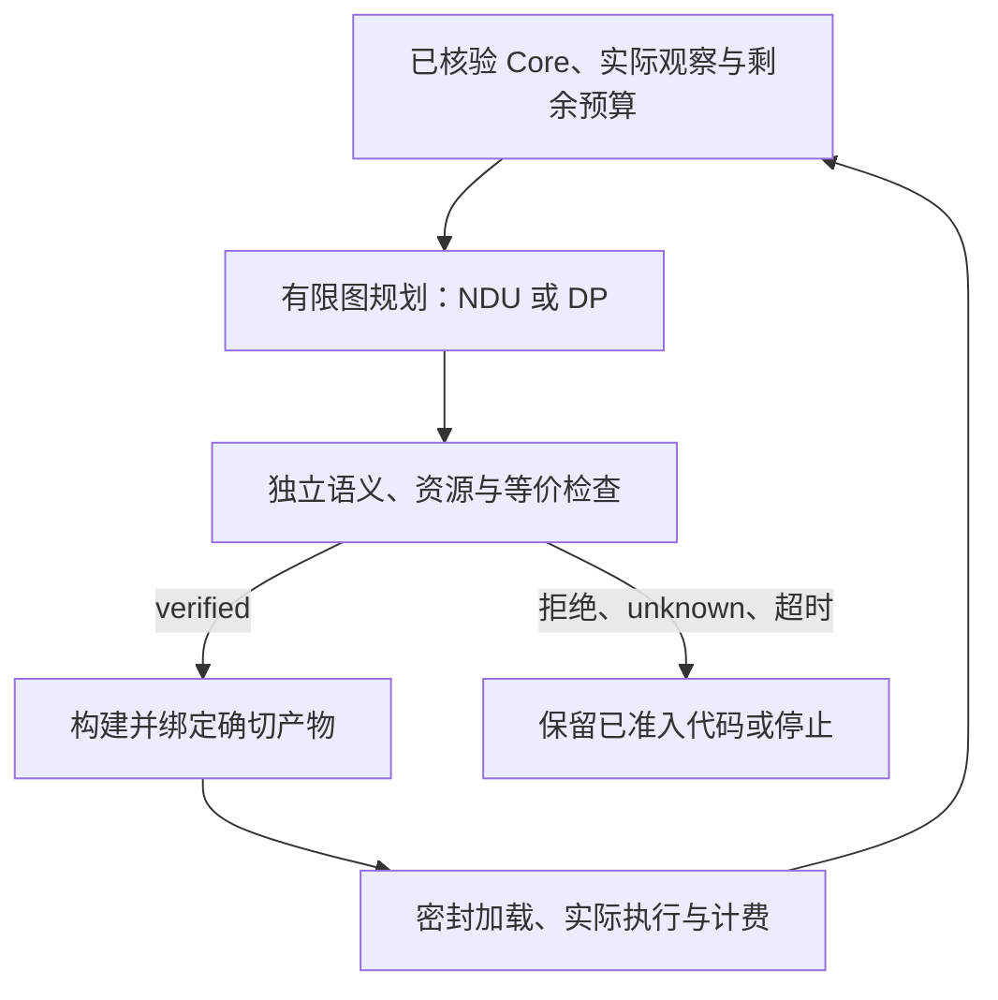

# HIA 五项交付：实现、最终组件资格与研究边界

日期：2026-10-30。实现代码锚点为
[`053d07045a06335011050277d3c563cf3ddefe70`](https://github.com/TrillionniumFoundation/Hepta/commit/053d07045a06335011050277d3c563cf3ddefe70)，
提交入口为 [PR #400](https://github.com/TrillionniumFoundation/Hepta/pull/400)。
测试观察器修正、独立实验和后续证据归档分别以其实际源码清单为准，不能仅凭这个提交号把不同快照的结果合并成一次运行。

**本轮已实现共同 Core 上的语义合同、受限跨调用证明链和有限 C++ profile 的真实实现迁移；NDU 的有限图压缩与原生对照也已执行。最终集成 175 项全部通过；双模型 Agent 复制完成 24/24 cells，但开发优势门槛未通过。** 第 3 项的第三方生产库代表性和低成本仍待证明；第 4 项“完整成本优于同目标轻量控制”和第 5 项“Agent 开发优势”仍未闭合。代码锚点 `053d07045a06335011050277d3c563cf3ddefe70` 的两条远端工作流均已通过；后续证据提交形成的最终 PR HEAD 需另行核对其对应 CI。

本轮证据不支持把 Hepta 宣称为已完成的通用 C/C++ 替代语言，也不支持“任意代码全局最优”“普遍超越 Rust”“任意 C++ 低成本自动等价翻译”或整个工具链的绝对安全定理。支持的进展是：把资源、行为、实际执行字节和测量成本接到同一条可拒绝、可重放的实现路径上。

## 1. 五项交付的验收状态

| 交付 | 本轮实际完成的内容 | 实现验收状态 | 仍未成立的更强结论 |
| --- | --- | --- | --- |
| 1. 统一语义与安全合同 | 明确整数、首个 trap、owner/loan、完整导出接口、预算停止和协作取消；修正不完整 native 导出准入 | 受限合同已实现；独立合同回归 70 项、零失败、零 skip；最终集成另计 | 全语言 soundness、LLVM/机器码 refinement、任意并发或 foreign code 安全 |
| 2. 跨调用证明与最终产物绑定 | 已解析单块 leaf call 的独立有序轨迹检查；与现有归纳式 guarded reduction 串联；绑定中间 Core、solver、目标和最终产物 | 最终独立资格通过：892 个语义输入、1,784 个 native 观察、38 个 VM 失败注入 | 任意递归/间接调用/跨模块等价证明；所有资源预算不变；后端正确性定理 |
| 3. 真实 C++ 组件实现迁移 | 仓库内构造组件的跨文件双 owner 生命周期、同步只借用回调、构造失败、取消与释放顺序；独立实现执行 | **局部实现验证通过**：两种配置共 2,370 例，原 C++ 与 HIA 各自对独立 oracle；没有以 bridge 充当实现迁移 | 既有第三方生产库代表性、通用 C++ 覆盖、标准库实现迁移、原 C++ 类 ABI 保持、人工低成本或完整经济收益 |
| 4. NDU 有限规划与真实成本对照 | 保留精确 Q32 获胜前沿的有限图压缩；原始 native NDU、同目标 Q32 DP 和全部既有控制臂；数值边界回归 | 压缩机制、原生差分、八臂执行和新增 11 项边界测试已通过 | 完整成本优于同目标 DP；真实未来成本预测准确；任意程序全局最优 |
| 5. Agent 表示对照复制 | 原三臂、双模型、四任务协议保持不变；重新登记并执行新回答，保留全部失败和成本 | **复制已完成，优势验收失败**：24 cells、47 次请求；Qwen 0/12、Granite 2/12，成功均为 Rust | compact HIA 相对 JSON HIA 或 Rust 的开发优势；跨模型优势结论 |

表中的独立资格各有冻结源码、登记和作用范围。测试数、案例数、原生观察数不是同一种计量，不能相加成一个“总覆盖率”。最终状态入口为
[ACCEPTANCE.json](../evidence/hia_five_deliverables_20261030/ACCEPTANCE.json)；
集成终态入口为
[integration/attempt03/RESULT.json](../evidence/hia_five_deliverables_20261030/integration/attempt03/RESULT.json)。
没有终态文件或终态不成功时，均不能把 pending 改为通过。

## 2. 共同语义：资源安全究竟保证什么

[执行与资源合同](HIA_SEMANTICS_CONTRACT.md)把紧凑 assembly、JSON Core、名义复合资源和受限源语言适配器接到实际的 standalone Core 上。源输入的哈希、canonical Core 的哈希和最后执行的 native 字节是不同身份；其中一个一致不能自动证明另外两个等价。

整数语义明确区分 checked 与 wrapping。checked 加减乘检查数学结果范围；checked shift 检查移位量，不能误解为结果也不丢位；有符号除法向零截断，余数随之定义。每个 block 的指令有顺序，首个实际 trap 发生后，后续读写、运算和释放不再执行。优化器不能用“最终数值一样”掩盖先发生的错误或不同的资源观察。

owner 是线性资源能力，loan 携带实际根、父子关系和读写权限。正常返回，包括用数值编码的业务错误，必须消费本地 owner 并结束本地 loan。仍被借用的 owner 不能移动或释放；父借用在子重借用期间暂停；调用不能复制 owner、制造冲突独占别名或让调用内借用逃逸。普通资源验证依然不足以证明 C++ 析构顺序正确，因此组件资格还比较独立的 native 事件轨迹。

本轮修正的一项实际 ABI 缺陷是：显式 `exports` 现在被当作完整接口合同。如果其中一个导出不能由所选 native 包装器完整表达，整个 emission/build 会拒绝，不能只发布兼容的子集。当前 native 公共边界仍是受限标量 C ABI；内部多结果或资源函数不因此获得任意外部 ABI。AArch64/RV64 的 emission 或 object 检查也不等于已在这些硬件上完成 native 执行资格。

返回、语义 trap、评估器预算停止和成功取消具有不同的资源含义。native trap 调用 `abort`，没有承诺其后运行语言析构；协作式 `cancel` 只有在取消过程正常完成时才算完成清理。取消过程中 trap 或预算耗尽必须传播停止状态。本轮没有新增通用线程、共享内存原子、后台异步执行或抢占取消，不能从同步任务合同推出一般并发的数据竞争自由。

上述独立回归实际运行了 70 项测试，零失败、零错误、零 skip，且源清单未漂移；其范围和日志见
[合同回归结果](../evidence/semantics_contract_20261030/RESULT.json)。它确认有限合同回归执行过，不构成所有输入和整个工具链的形式化证明。

## 3. 跨调用优化：从完整 leaf 实现到 guarded 证明链

新增 [hia_call_expansion.py](../hepta/hia_call_expansion.py)处理已经解析到完整定义的单块 leaf 函数。caller 可以包含循环、分支、多 owner 和 loan；被展开的 callee 必须只有一个入口 block、正常 `ret`，且没有嵌套 `call`。函数指针未知目标、foreign 实现、递归或没有完整定义的函数不属于这条规则。

提案器负责参数替换和新 SSA 名称；检查器独立构造原调用的有序轨迹，逐项比较实际 candidate 的操作、参数身份、类型、属性和 CFG 出口。原程序和候选程序都重新通过普通 Core verifier，所有函数和 block 都参与检查，未列出的函数体也不能被偷偷改动。即使两个版本都能平衡分配/释放计数，改变释放次序的候选仍会被拒绝。

第二步把 leaf 展开后暴露的逐字节 producer 交给现有 guarded reduction。验证器证明入口条件、归纳 CFG 边和被消除 overflow check 的义务，保留完整 checked fallback。证明链要求第一步 candidate 哈希等于第二步 base 哈希，再核对实际生成的最终 Core。两个阶段目标不一致、陈旧中间结果、伪造不变量、扩大到不安全范围的 guard、solver `unknown` 或超时都会拒绝。

native 构建还核对 fresh LLVM emission 与实际构建回执中的 Core、输入、IR、实现、完整导出接口、目标和产物身份。checker/solver 身份在关键阶段重新核验，最终执行来自与回执一致的密封字节。真实编译错误 Core、身份漂移和缺失回执身份的负控均用于防止把“有一张证明”误认为“这份执行产物已被证明绑定”。规则与边界详见 [调用展开合同](HIA_CALL_EXPANSION.md)。

最终独立资格的分母如下：

| Profile | 语义输入 | 原程序与候选的 native 观察总数 | VM 分配失败注入 |
| --- | ---: | ---: | ---: |
| 资源循环 | 10 | 20 | 8 |
| 展开后 guarded 资源循环 | 10 | 20 | 8 |
| 名义复合资源 | 5 | 10 | 8 |
| 只借用调用及 trap | 3 | 6 | 6 |
| 实际 C++ 捕获组件 | 864 | 1,728 | 8 |
| 合计 | **892** | **1,784** | **38** |

源与 component 输入的结束检查均通过，完整区间为 54.561269853 秒。C++ 组件观察明确包含 callback error `4001`。证据见
[call-expansion/SUMMARY.json](../evidence/hia_five_deliverables_20261030/call-expansion/SUMMARY.json)及
[原始归档](../evidence/hia_five_deliverables_20261030/call-expansion/raw.tar.xz)。

这条变换明确不保持解释器 fuel、调用深度预算、诊断位置或栈用量：移除一次调用就可能改变这些结果。资格中的 38 项是 VM 分配失败观察，不能写成 38 次 native 失败注入；调用展开 qualifier 也没有声称测得 native 分配轨迹。组件的实际 allocator 观察由下面的独立组件资格承担。

## 4. C++ 迁移：真正重写实现，也保留成本不利结果

新增 profile 为 `cpp20-captured-unique-owner-synchronous-borrowed-callback-v1`。本次 `callback_project_migration` 是为了这个有限 profile 构造、并实际编译/迁移/运行的仓库内组件；**本轮没有迁移一个既有第三方生产库**。原生迁移链真实执行成功，验证了这个组件的实现路径，不能因此把第 3 项的生产代表性也标为完全达标。
[示例组件](../examples/cpp/callback_project_migration/)含两个 translation unit、完整 owner 头文件和三个自由函数实现：入口创建并填充两个独占字节数组，把复合 owner 移到另一文件的 consumer，再调用一个实际 C++ 函数指针。callback 只在同步调用期间借读 owner，返回计算值或错误。

迁移生成了入口、consumer、callback 和复合算法的实际 Hepta/Core 实现。目标没有链接原 C++ object，也没有靠 C++ callback thunk 完成工作。闭合 callback 绑定被检查后专门化为直接 Core 调用。默认 deleter 的 `unique_ptr<unsigned char[]>` leaf 仍依赖明确、重新检查的编译器合同，标准库本体没有被迁移；这与“自动翻译整个 C++ 标准库”是不同范围。

资源合同覆盖按字段顺序构造、逆序释放、分配拒绝、leaf/composite 构造失败、跨文件移动前后取消、索引错误、callback 错误及成功返回。空绑定、借用逃逸、强制转换后写入、读取 moved-from owner、重复 callback 和缺失定义拒绝整个迁移。详细边界见 [CPP_CALLBACK_PROJECT_CONTRACT.md](CPP_CALLBACK_PROJECT_CONTRACT.md)。

### 4.1 最终完整资格

本节只使用最终冻结生产代码的完整运行：原工作目录为 `/tmp/hepta-five-integrated-20261030-02/callback/`，编译器源码哈希为 `53212a3a91c572de11f5f23448111fe74a91fb72288f7f44c0d6e16c413343a5`。更早开发快照和 cost-only 扩展不冒充这次资格。稳定归档入口为
[component/SUMMARY.json](../evidence/hia_five_deliverables_20261030/component/SUMMARY.json)及
[component/raw.tar.xz](../evidence/hia_five_deliverables_20261030/component/raw.tar.xz)。

| 配置 | 输入案例 | 实际分配 / 释放 | 分配拒绝 | 最终 live owner | live bytes / owner 高水位 |
| --- | ---: | ---: | ---: | ---: | ---: |
| `three_weight` | 1,185 | 932 / 932 | 579 | 0 | 1,764 bytes / 2 |
| `five_weight` | 1,185 | 932 / 932 | 579 | 0 | 1,764 bytes / 2 |

两配置合计 **2,370 个案例，原 C++ 和 HIA 各自完整运行这 2,370 例**，并分别对照独立 Python 值/事件模型。它们不是由同一实现互相“证明正确”。每配置有 11 个 callback 错误案例、移动前后取消各 31 个案例，以及各构造失败、边界和分配拒绝分支；高水位来自真实 allocator hook 与独立事件 oracle 的比较。

每个配置捕获并逐项处置 154 个活跃项目声明；92,058 个标准库声明被登记为外部合同边界。三处自由函数实现全部迁移，原 C++ bridge 函数计数为 0，标准库实现迁移计数为 0，一般 C++ 覆盖百分比为 `null`。这里的“完整”只指声明的构建矩阵和组件 profile，不是一般 C++ 的覆盖率。

八项 Core/native 负控同时保留：删除 drop 在发布前被资源检查拒绝；错误释放顺序、callback 错误码和取消返回值虽然仍能通过资源检查，却被独立 native oracle 发现。这直接表明资源安全与源行为等价是不同义务。

### 4.2 稳态更快，百万次调用的完整已测净账仍为负

实际捕获/迁移墙时为 **96.898858629 秒**；含后续资格步骤的整个运行区间为 **120.566576173 秒**。后者包含前者，不能再把两者相加。人工合同设计和迁移器实现的人时没有外部观测，`human_engineering_seconds` 仍为 `null`，不得用这些工具墙时推算。

比较使用相同独立 C caller、输入与结果校验。原 C++ 同时包含 Clang 20 `-O3` 分文件基线和强 `-O3 -flto`/LLD 基线；HIA 为 Clang 20 `-O3` 的单 LLVM module。每场景 200,000 次调用、五次重复，顺序轮换；分配、callback 与清理都在执行计时内。下表的比例为 **C++ LTO 时间 / HIA 时间**，大于 1 表示该次稳态测量中 HIA 更快。

| 场景 | C++ LTO 中位 ns/调用 | HIA 中位 ns/调用 | LTO/HIA | 估计回本调用数 | 百万次调用扣除前置成本后的净节省 |
| --- | ---: | ---: | ---: | ---: | ---: |
| `three_weight` 成功 | 97.080585 | 77.062610 | 1.2598 | 4,854,649,106 | **−97.160226447 s** |
| `three_weight` 错误/取消 | 163.520310 | 102.310200 | 1.5983 | 1,587,650,217 | **−97.119034312 s** |
| `five_weight` 成功 | 87.235800 | 58.663730 | 1.4870 | 3,421,542,431 | **−97.731977759 s** |
| `five_weight` 错误/取消 | 159.156350 | 95.635700 | 1.6642 | 1,539,035,729 | **−97.697029179 s** |

摊销比较的起点是已经构建好的 C++ LTO 程序。每个场景都明确计入整个两配置迁移成本，加上该 HIA 目标实际 build/link 成本，不凭空分配一个更小的“单配置迁移份额”。上述净账用测得的每调用中位差估计，并非另一次长期部署观测；它没有计入未知人工合同工作，也不保证未来复用次数和输入分布。

两个配置的 benchmark HIA ELF 均为 **16,472 bytes**，C++ LTO ELF 均为 **10,632 bytes**，分文件 C++ 为 17,456 bytes。这是整个 benchmark 文件大小，不是只量 `.text`，也不是整个迁移器或所有依赖的大小。HIA 在该强 LTO 比较中没有二进制尺寸优势。进程 RSS 与 owner live-byte 高水位也是不同指标，不能互相替代。

因此本轮可以报告限定场景的稳态速度提升和正确的资源观察，不能只报 1.26～1.66 倍而省略约 97 秒前置净负账、较大 ELF 和未知人时，更不能据此宣称已经实现低成本通用迁移或 Rust 性能普遍不劣。

## 5. NDU：有限图压缩正确，完整净收益优势仍未成立

[hia_planning.py](../hepta/hia_planning.py)增加精确有限图压缩，把保留的真实路径交给未替换的 Rust NDU。`exact_finite_plan` 则提供同一 Q32 目标、相同 tie/abstain 语义的轻量控制，明确标记 `native_evaluation=false`。这避免把“两个控制器的数学目标不同”误当成 NDU 本身的优势。

当前 profile 限定为最多 8 个状态、32 条转移、4 个未来批次，共同终值、单位 discount、零路径风险和单一加性总成本上限。它完整搜索这个已声明图，不能推断图外所有机器指令、任意算法重写或未知硬件未来行为。费用按每个事件转换成 Q32 后再相加；先合计纳秒再转换会改变结果。例如总费用同为 2 ns 的两条路径，单事件 debit 为 8,589，而两个 1 ns 阶段之和为 8,588，原生目标严格偏好后者。

压缩必须保留预算可行的完整最优前沿和所有必要同值路径，不能用随机两个样本代表很大的 tie。一个 656 路径图可以压到 native 候选容量内；同结构的全零成本图会因完整同值前沿过大而拒绝。未知、拒绝、超时状态不会变成可执行权限，搜索限额耗尽不会发布部分“最优”答案。详细条件与独立穷举见 [HIA_NDU_COMPRESSION.md](HIA_NDU_COMPRESSION.md)。

### 5.1 数值边界和“等价”的准确层级

新增数值边界资格实际执行 **11 项测试、12 次原生调用，零 skip**，冻结生产代码未变化。其中两次全量 native request 拒绝是预期观察：未压缩路径可以因过大累计成本造成 i64 编码溢出或超出 utility profile，而压缩先排除不可负担路径后仍能产生合法请求。

所以等价结论是：在共同验证的有限图 profile 内，保留可行候选的完整获胜前沿、建议和 disposition；**不声称未压缩与压缩请求的整体接受/拒绝行为在这些数值越界情况下也完全相同**。保留路径受 `completion_value_ns <= 10^12`、`remaining_budget_ns <= 10^12` 和非负成本约束；后续放宽这些界限必须重新检查数值证明。结果和范围见
[数值边界 GATE](../artifacts/hia-ndu-numeric-boundaries-20261030/GATE.json)与
[SCOPE](../artifacts/hia-ndu-numeric-boundaries-20261030/SCOPE.json)。

### 5.2 相同目标和完整成本使负结果可见

独立四控制实验保留九次重复，控制流水线中位耗时分别为：旧纳秒 DP 0.725350 ms、精确 Q32 DP 1.210466 ms、原生全枚举 8.250853 ms、原生压缩 4.098156 ms。八个实际 native 差分案例的完整前沿、建议与 disposition 一致。压缩降低了该次原生输入构造/传输/执行开销，但仍慢于同目标 Q32 DP；这些控制器夹具成本不能直接当作整个程序的净收益。见
[四控制结果](../artifacts/hia-ndu-compression-four-controls-20261030/RESULT.json)。

进一步的八臂 pilot 真实执行了证明、构建、加载和 workload；所有八个 episode 都完成，输出检查和注册预算都通过。它是共享主机上的单组 pilot，使用 19 次调用、5 元素初始 probe，以及 5/19/47 元素的后续批次。完整账目如下：

| 控制臂 | 实际 episode 墙时 | 注册范围内 standalone 总成本 |
| --- | ---: | ---: |
| 固定原始代码 | 0.562257 s | 2.614042 s |
| 固定 small | 1.147790 s | 3.199575 s |
| 固定 wide | 1.239326 s | 3.291111 s |
| 校准最佳固定计划 | 0.513049 s | 2.564834 s |
| 旧纳秒 DP | 0.507032 s | 2.560208 s |
| 精确 Q32 DP | 0.505286 s | 2.560145 s |
| 原生 NDU 全枚举 | 0.626027 s | 27.239987 s |
| 原生 NDU 压缩 | 0.472808 s | 27.080783 s |

每个 native standalone 总账都计入同一原始二进制 manifest 中 **24.541661996 秒**的构建成本；这是复用二进制的原始构建记录，没有冒称本次重建，也没有把它改记为零。共同校准/证明/driver 成本按每个 standalone 策略计一次，各臂实际决策、构建、执行和证据写入归入自身账目。工具安装、既有依赖缓存取得和最终汇总写入仍是声明的排除项。

固定 small/wide 实际发生两次重新提案、证明、编译和安装转移；两种 NDU、Q32 DP 和最佳固定计划都选择停止继续优化，并在当前代码上交付余下工作。`stop` 仍要完成 workload，不能等同于零工作、零成本的 `abstain`。完整证据见
[八臂结果](../artifacts/hia-ndu-eight-arm-20261030/RESULT.json)。之前七臂 pilot 中压缩原生的 episode 反而更慢，原记录也保留；不能挑选八臂中 0.472808 秒一项推导总体排名。

这里得到的是压缩机制和受控原生执行的有效性，**没有得到相对精确 Q32 DP 的端到端净收益优势**。NDU 的 `authority` 始终是 `DENY_ALL`，`safety_certificate=false`：它提出建议，资源与语义许可来自独立检查，执行还要核对实际产物和实际预算。

这条闭环允许根据新测量重新规划，但不会因为目标分数较高而绕过证明，也不会把有限图中的最优路径升级成所有程序的全局最优。

## 6. Agent 复制：24 个 cells 完整结束，优势门槛失败

[本轮复制说明](../experiments/hia_five_deliverables_20261030/agent_replication/README.md)保持原 v4 三臂：JSON HIA、compact HIA assembly、Rust；两个固定模型各做四个维护/API 升级任务，共计划 24 cells。原任务、prompt、schema、顺序、两次尝试上限、隐藏测试和门槛来自基线提交，未按本轮模型回答改写。这是公开旧任务的新快照复制，**不是新的盲测任务**。

启动前保留了 tokenizer/context 容量、源码闭包、实际模型和 runtime 身份、20 项编排单元控制、36 项参考/部分迁移控制及九项恶意 provider 控制。fake engine 单元测试输出、人工参考解和控制夹具不计模型成功。第一次容量检查因受限执行环境不能绑定原有 Unix socket 而失败，保留记录；之后在已授权环境中执行同一协议，没有删除进程拥有权和身份检查。

两个家族现已完整结束，所有计划 cell、usage 和身份检查都完整，没有 timeout、基础设施中断或人工修复。Qwen 实际发起并收到 24 次新请求，Granite 为 23 次，合计 **47 次**。成功与总 token 分母如下；每臂每模型均为四个任务，token 包含真实输入、输出和失败尝试。

| 模型 | JSON HIA 成功 / 总 token | compact assembly 成功 / 总 token | Rust 成功 / 总 token | 模型总结果 |
| --- | ---: | ---: | ---: | --- |
| Qwen coder 1.5B | 0/4；20,220 | 0/4；11,111 | 0/4；7,541 | 0/12；38,872 tokens |
| Granite 2B | 0/4；19,244 | 0/4；12,843 | 2/4；6,921 | 2/12；39,008 tokens |
| 两家族合计 | 0/8；39,464 | 0/8；23,954 | 2/8；14,462 | **2/24；77,880 tokens** |

Granite 的两次成功是 Rust 的 `clamped_delta_bias` 和 `floor_multiple_v2`。两家族的 maintenance/upgrade 门槛及 assembly 对 JSON HIA 的门槛均为 false。compact 表示虽然在这次失败轨迹中消耗的 token 少于 JSON HIA，却没有完成任何一个任务，不能被包装为开发生产力优势；也不能因为 Qwen 三臂都失败就宣布等效。

两个模型实验区间分别为 704.709094333 秒和 1,166.038060453 秒；这些区间含各自运行的嵌套步骤，不应与内部 request、inference 和 validation 再相加。小模型、已公开任务和有限项目的负结果也不能反向证明所有未来模型都无法受益；它们准确否定的是本轮预先登记的优势验收。

复制证据根为
[reproduction-01](../experiments/hia_five_deliverables_20261030/agent_replication/reproduction-01/)，
已有 [REGISTRATION](../experiments/hia_five_deliverables_20261030/agent_replication/reproduction-01/REGISTRATION.json)、
[COMMANDS](../experiments/hia_five_deliverables_20261030/agent_replication/reproduction-01/COMMANDS.json)和冻结源码归档。
完整汇总、源闭包重绑定和原始归档以该目录最终 `READOUT.json` 为索引。本节数字来自两份实际 `MODEL_RESULT.json` 终态，不能用启动前控制或 fake-engine 单元记录替代这些模型结果。

推理、完整 token、提交次数、native 编译和验证、身份检查、进程关闭及归档等成本按各自范围记录；已缓存模型下载不冒称新下载，未知人工工程时间仍为 `null`，嵌套区间不重复相加。拒绝模型生成的非法 Core 表明准入边界起作用；它本身不是 Agent 能以更低成本完成开发任务的证据。

## 7. 集成回归、失败保留与 CI

最终组件和调用展开资格已经成功，并不意味着此前集成尝试全部成功。两次失败按原样保留：

| 集成尝试 | 实际结果 | 已定位原因与处理 |
| --- | --- | --- |
| attempt01 | 156 项执行，1 个 error、零 skip，失败 | 新测试在父进程重复通过 `/proc/self/fd/N` 加载不同库，文件描述符复用使 `dlopen` 命中旧库，出现 `full_lifecycle` 符号缺失 |
| attempt02 | 164 项执行，1 个 error、零 skip，失败 | 隔离改动调用了仅支持既有窄观察 profile 的 helper，拿它观察 `u64` 入口，被边界正确拒绝 |
| attempt03 | **175 项全部通过，零 failure、零 error、零 skip** | 使用正确的独立 64 位 native child 观察；305.034023346 秒，源清单结束检查不变 |

前两次没有被删除、改成通过或解释成生产功能已经验证成功。第三次增加了 11 项数值边界测试；完整 callback native 资格作为明确列出的外部门禁，已由 attempt02 同目录下那次独立完整资格实际通过，避免重复执行同一项昂贵集成测试。它不是 skip，也没有虚构一次 attempt03 的 callback 重跑。

attempt03 的 `QUALIFICATION_SOURCE_REBIND.json` 逐字节核对 `hepta`、`tools`、`examples` 与已执行组件/展开资格的快照一致；差异仅为测试观察器修正和增加数值边界测试。最终集成源码内容哈希为 `2260c364ffde304045c64dd45f2fc6a0b20aa4c7a6867522d43c9b7e80725f44`。这使现有实际观测可以绑定到未变的生产实现，而不是靠声称“测试修好了”掩盖代码变化。

新增 [CI workflow](../.github/workflows/hepta-intelligent-assembly-closure.yml)固定 PR head，安装 Python/Z3/Clang 20，要求所选测试零 skip，并实际执行 callback 与 call-expansion qualifier。原 native NDU 可以通过手动 dispatch 的独立 job 请求；未请求时明确记为 `not_qualified`，请求后私库访问、原生构建或执行失败不能被写成通过。CI 不把共享主机上的相对速度作为硬门槛。详细操作见 [CI 说明](INTELLIGENT_ASSEMBLY_CI.md)。

代码提交 `053d07045a06335011050277d3c563cf3ddefe70` 的两条远端工作流现已实际完成，API 返回的 `head_sha` 均与该提交一致：

| 工作流 | 实际运行 | 终态与资格范围 |
| --- | --- | --- |
| HIA intelligent assembly closure | [41014255889](https://github.com/TrillionniumFoundation/Hepta/actions/runs/41014255889) | `completed / success`；核心单元测试、真实 callback 资格和 call-expansion 资格完成 |
| HIA verified optimization and native NDU integration | [41014255817](https://github.com/TrillionniumFoundation/Hepta/actions/runs/41014255817) | `completed / success`；既有独立 `verified-native` 工作流的实际 native 门禁通过 |

closure 中的 `Optional original native NDU qualification` job 本次没有通过手动 dispatch 请求，按合同为 `skipped`；它没有执行，不能被记作该可选 job 的资格。上表实际原生 NDU 门禁通过来自另一条独立的 `verified-native` 工作流，两者的范围不能混同。

这些成功状态严格属于 `053d` 代码提交。后续文档、测试或证据归档提交改变 PR HEAD 后，其对应 CI 必须从 [PR checks](https://github.com/TrillionniumFoundation/Hepta/pull/400/checks)重新核对 `head_sha` 和终态；本节不把旧提交的成功转移给尚未验收的最终 HEAD。

## 8. 可据此继续推进的范围

证据发布还为新 workflow 增加已保存证据的逐文件哈希门禁，并给原生 workflow 增加完整 `test_hia_planning` 与 `test_hia_planning_boundaries` 的零 skip 执行。它们属于后续提交的 CI 配置，不能追计为上述代码锚点已经执行的步骤。

下一步可以继续扩大受限 profile：给更多真实组件补完整资源和失败合同，扩展可独立检查的调用/CFG 变换，并让规划器围绕已测成本决定是否值得重新证明和编译。每次扩大都应携带新反例、实际源实现差分和最终执行身份，不能仅增加一个语法入口。

第 3 项需要从构造组件走向事先选定的既有第三方生产组件，登记未支持声明、所需人工合同和实际人工成本。第 4 项需要在同一目标函数、同一信息、同一预算和完整成本下证明可重复收益；目前原生压缩优于原生枚举的局部观测没有跨过这个门槛。第 5 项本次已完整结束且门槛失败；后续应另行登记新的受控任务来判断失败原因和跨模型效果，不能事后修复旧答案再算成 Agent 成功。

本轮交付的价值在于把这些差别做成代码和证据：安全准入、实现迁移、native 绑定、模型行为和净成本都可以分别失败。现有结果支持继续开发 AI 可操作的 typed assembly 与验证优化系统；仍不足以交付“对任意代码动态规划每条最优指令，同时绝对安全且全面超越 Rust”的通用承诺。
