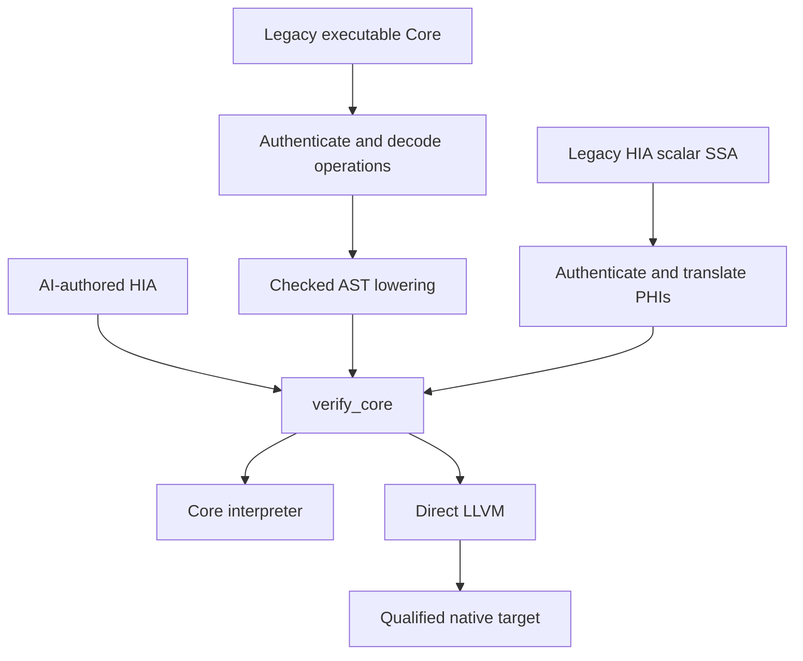

# HIA standalone programs: normative executable profiles

This document defines the independently checked primitive
`hepta.hia.program.v1` through `hepta.hia.program.v7` profiles and the distinct
structural nominal input namespaces `hepta.hia.composite.v1` and
`hepta.hia.composite.v2`. Their
executable admission authority is `hepta.hia_program.verify_core` (also exposed
as `hepta.core.verify_core` and `verify_program`). The direct interpreter and
LLVM backend consume the same immutable, reverified program bytes. No original
Hepta, C, C++, Rust or assembly source is required to admit or execute this
program. A caller-provided hash, proof claim or producer receipt grants no
additional permission. Composite v1 input is structurally elaborated into
primitive v6; composite v2 input is elaborated into primitive v7. In both cases
the complete resulting core is independently rechecked. Admission does not
depend on a source-language checker or a producer's assertion.

This is a typed, resource-aware assembly/IR for agent editing. It deliberately
retains explicit values, control-flow edges, calls and resource instructions;
it does not ask a model to infer invisible ownership from machine addresses.
The accepted profile is finite. It is not a proof of full Rust soundness,
arbitrary C/C++ equivalence, or optimal machine code.

## Standalone executable authority and explicit frontends



`hepta.core.from_executable_core` first checks the old source-bound envelope,
decodes its actual executable operations and lowers the decoded, checked AST.
`hepta.core.from_scalar_core` first authenticates the old SSA envelope, then
translates its actual instructions, predecessor-selected PHIs and edges. A
backwards liveness pass makes every cross-block input explicit. It never
substitutes default zero values for unavailable predecessor data. The old
resource gate is preserved during import; new ownership and loan rules then
check the executable result itself.

`hia_program_source.lower_source` is a frontend. Source inference and
source-level `semantic_ir.py` remain relevant to that frontend and to the
broader historical Rust/C paths. They do not become authorities for a submitted
standalone HIA program. The old commands remain compatibility paths with their
original documented scopes. Unsupported source constructs must reject during
lowering; their existence in the Rust reference frontend does not enable them
in this core.

These boundaries apply to the standalone path. They do not reroute every
historical compiler command through `verify_core`. The similarly named
representations have different responsibilities:

| Representation or entry | Current responsibility | Relationship to standalone HIA |
| --- | --- | --- |
| [`semantic_ir.py`](../hepta/semantic_ir.py), `hepta.hsir.v0` | Canonical snapshot of checked source syntax, types, effects and external obligations | Source-bound frontend representation; neither an independently executable Core nor a backend-refinement proof |
| [`hsir.py`](../hepta/hsir.py), `hepta.hsir.scalar.v1` | Closed scalar compatibility view derived from the canonical semantic snapshot for the experimental CFG/SSA path | Cannot grant source semantics absent from the canonical snapshot; actual checked SSA operations can be explicitly imported |
| [`hia_core.py`](../hepta/hia_core.py) and [`executable_core.py`](../hepta/executable_core.py) | Historical source-authenticated scalar-SSA and structured executable envelopes | `from_scalar_core` and `from_executable_core` preserve their admission checks, translate their operations and reverify the resulting primitive v1; these old envelopes are not standalone wire aliases |
| [`resource_lowering.py`](../hepta/resource_lowering.py) and [`resource_ir.py`](../hepta/resource_ir.py) | Source-to-resource abstraction and an independent owner/loan CFG verifier; scalar values are abstracted | Resource graphs are not complete executable programs and are not accepted by `verify_core`; source backends use some verified type/layout metadata, without a source-refinement or scalar-behavior proof |
| [`owned_drop_plan.py`](../hepta/owned_drop_plan.py) | Derives finite child-destruction decisions from verified, source-derived Resource IR types | Partial Resource IR consumption by the source-owned LLVM emitter; its scalar expressions, CFG and allocation behavior still come from checked source |
| [`native_resource_gate.py`](../hepta/native_resource_gate.py) | Mandatory source-bound resource check for its historical scalar LLVM path | Retains its own source/profile gates; a Resource IR receipt cannot replace standalone validation |
| [`hmir.py`](../hepta/hmir.py), `hepta.hmir.cfg-ssa.v0` | Conservative scalar CFG/SSA pilot | Neither a borrow checker nor executable codegen input; distinct from the actual SSA import above |
| [`hia_schema.py`](../hepta/hia_schema.py), `verify_core`, direct VM and LLVM consumers | Versioned standalone operations, resource transitions and executable admission | No source is required after successful conversion; each consumer reverifies the exact program it uses |

Historical Rust reference, C emission, source LLVM, C/C++ retained-library
bridges, local stored-view and task/I/O composition paths keep their own
contracts and qualification evidence. A successful source-path test is not
evidence that its construct has a standalone encoding. In particular,
source-native stored-view lowering does not establish that
`hia_program_source` can lower the same record view to standalone HIA, and
source runtime task/I/O support does not add I/O to the cooperative task Core.
The local-view C/LLVM emitters also check layouts against verified Resource IR
types. These existing metadata and Drop-plan consumers must be preserved;
they do not turn the abstract resource graph into an alternative standalone
executable authority.

## Wire format and immutable identity

`hepta/hia_schema.py` is the shared version registry. A schema selects an
instruction grammar; it is never a safety receipt or permission to skip
verification. Primitive schemas remain exact, cumulative capabilities:

| Input schema | Additional capability | Executable identity |
| --- | --- | --- |
| `hepta.hia.program.v1` | Typed scalar SSA, owners, loans and byte access | Original v1 bytes |
| `hepta.hia.program.v2` | Bulk byte copy and fill | Original v2 bytes |
| `hepta.hia.program.v3` | Overlapping in-place byte movement | Original v3 bytes |
| `hepta.hia.program.v4` | Byte swap | Original v4 bytes |
| `hepta.hia.program.v5` | Copy with source and destination offsets | Original v5 bytes |
| `hepta.hia.program.v6` | Fill a checked subrange | Original v6 bytes |
| `hepta.hia.program.v7` | Runtime-sized linear chains of owned byte buffers | Original v7 bytes |
| `hepta.hia.composite.v1` | Generic nominal products, enums, stored local loans and cooperative tasks over all v6 operations | Independently checked primitive v6 normalization |
| `hepta.hia.composite.v2` | The same nominal operations over v7, including primitive chain fields and task state | Independently checked primitive v7 normalization |

The registry deliberately distinguishes `CANONICAL_CORE_SCHEMA` (v6, the
existing composite-v1 normalization target) from `LATEST_CORE_SCHEMA` (v7).
`composite_core_schema(input_schema)` selects the exact target; no consumer
may replace that selection with an unconditional latest-version upgrade.
The registry's legacy singular `composite` entry describes v1; the full
`composite_versions` list describes both versions. Primitive input retains
its declared version and canonical identity during ordinary verification.
Explicit `hia upgrade-v7` changes the schema only after checking the old and
new programs; it does not add operations or prove source/native equivalence.

Historical development also used the spelling `hepta.hia.program.v2` for a
nominal format. Ordinary loaders now interpret that spelling only as primitive
v2. They never guess a grammar from a `types` field. The explicit
`hia import-composite-v2` adapter checks the old nominal grammar and its old
instruction capability, then normalizes it to v6. An old nominal document
cannot smuggle a newer instruction through that adapter. Similarly, a Core
upgrade with the ambiguous legacy v2 spelling requires its explicit primitive
profile. Silent profile inference is forbidden. Despite its historical command
name, `import-composite-v2` is not the loader for the current
`hepta.hia.composite.v2` namespace: current composite v2 goes directly through
`verify`, `run`, `normalize` and `build`.

Programs use UTF-8 JSON. Whitespace and key order are accepted on input; the
verified snapshot canonicalizes keys and separators. Duplicate object keys,
nonfinite values, floating JSON numbers, invalid identifiers, unknown fields
and unsupported schemas reject. Limits include 8 MiB encoded input, nesting
depth 64, 262,144 structural nodes, 1,024 functions and 4,096 blocks per function.

The primitive top-level shape is:

```json
{"schema":"hepta.hia.program.v1","module":"example","functions":[]}
```

An optional `exports` list declares the exact public scalar entrypoints. It
must contain unique existing function names with primitive scalar parameters
and results. When absent, the original v1 rule exposes scalar-signature
functions; existing canonical v1 identities do not change. Composite normalization
always emits `exports`. Both the interpreter and native backend obey the core's
list after serialization and reload; source origin is not needed to preserve
the public boundary. Exporting an owner/view descriptor is forbidden. Native
C wrappers additionally require at most one scalar result.

The example above illustrates fields only: a real program must have at least
one function. A function has exactly `name`, `params`, `returns`, `effects`,
`entry`, and `blocks`. A parameter is `{"name":"value","type":"u32"}`.
`returns` is an ordered list of types, including an empty list for no result.
Each block has exactly `id`, `params`, `ops`, and `term`.

Every instruction has exactly:

```json
{"op":"int.add.checked","args":["x","one"],
 "out":[{"name":"answer","type":"u32"}],"attrs":{}}
```

Identifiers are bounded ASCII letters/digits/underscores with a non-digit
first character. `__hia_` is reserved, and runtime symbol collisions such as
`calloc`, `free`, and `abort` cannot be function names. The verifier rejects
duplicate SSA definitions across the whole function, including block inputs.

`VerifiedProgram` holds immutable canonical bytes. Public construction of that
Python dataclass is possible and is not a trust boundary: inspection,
interpretation, emission and native compilation reverify its exact content.
`as_dict()` returns a detached copy. SHA-256 identifies bytes, not truth,
authorship, equivalence or authorization.

## Values, blocks and effects

| Component | v1 semantics |
| --- | --- |
| Integer values | Signed and unsigned 8/16/32/64-bit integers; `isize`/`usize` are fixed at 64 bits |
| Other scalar values | `bool`, `unit`; unit's JSON constant is `null` |
| Resource values | `buffer`, `readbuf`, `mutbuf` |
| Block visibility | Only explicit block parameters and earlier local instructions are visible |
| Entry | Entry parameters exactly equal the function signature; incoming entry edges reject |
| Edges | Exact argument count/types; every live local owner and loan travels or is consumed |
| Branches | Exclusive alternatives; each edge checked independently |
| Joins/loops | Normalized ownership/loan origin/parent/permission state must agree for all predecessors |
| Effects | `alloc`, `read`, `write`, `trap`; every operation and callee effect must be covered |
| Calls | Statically named module functions; no foreign calls or indirect function pointers |
| Reachability | Every declared block must be statically reachable; unreachable payloads reject |

Extra declared effects are allowed; missing required effects reject. Recursion
is permitted in the core and is not a proof of termination or stack bounds.
The interpreter has an independent depth limit. A native caller must provide
ordinary platform stack resources.

### Scalar instruction set

| Instructions | Rules |
| --- | --- |
| `const` | One exactly typed scalar output; attributes contain only `value` |
| `int.add/sub/mul.checked` | Equal integer types; overflow aborts |
| `int.add/sub/mul.wrap` | Equal integer types; modulo word width |
| `int.div/rem.checked` | Division truncates toward zero; divisor zero and signed minimum divided by -1 abort |
| `int.shl/shr.checked` | Shift count must be in `[0,width)`; left shift wraps discarded bits; signed right shift is arithmetic |
| `int.neg.checked` | Result must fit the output integer type |
| `bit.and/or/xor/not` | Fixed-width bit operations |
| `compare.eq/ne/lt/le/gt/ge` | Equal integer types; equality/inequality also admit booleans |
| `bool.not/and/or` | Boolean values; both argument values already exist, so these are not source short-circuit expressions |
| `int.cast` | Attribute `mode` is `checked` or `wrap`; checked range violation aborts |
| `select` | Boolean condition and two equal scalar types; cannot duplicate/select owners |
| `call` | Attribute `function` names a checked function; outputs exactly match all return types |

Source short-circuit Boolean operators lower to branches. In particular the
unselected side of a source `||` is not eagerly executed by `bool.or`.

### Terminators

```json
{"op":"ret","values":["answer"]}
{"op":"jump","target":"loop","args":["next"]}
{"op":"branch","cond":"condition",
 "then":{"target":"yes","args":[]},"else":{"target":"no","args":[]}}
{"op":"trap","code":"bounds"}
```

Trap codes are `user`, `overflow`, `division_by_zero`, `bounds`, `allocation`.
Native traps abort the process. No destructor cleanup after an abort is
promised. Normal return, including errors represented as returned values,
must consume or explicitly return every owned capability and end local loans.

## Resource semantics

`buffer` is a linear owner of initialized bytes. An empty owner is still a
capability and must be consumed exactly once. Native runtime metadata is a
pointer and length; it is private to the implementation and is not an external
safe C aggregate API.

| Instruction | Resource transition and dynamic behavior |
| --- | --- |
| `buffer.new(size)` | Creates one zeroed byte owner; allocation refusal aborts |
| `buffer.try_new(size)` | Returns `(buffer,bool)`; refusal returns an empty owner and false |
| `buffer.len(value)` | Reads a buffer/view's length without copying ownership |
| `borrow.read(value)` | Creates a shared child view; conflicting mutable loans reject |
| `borrow.mut(value)` | Creates an exclusive child view from an owner/mutable view; aliases reject |
| `loan.end(view)` | Ends a locally created view after its child loans have ended |
| `owner.move(owner)` | Consumes the old name and creates a new owner name; outstanding loans reject |
| `owner.drop(owner)` | Consumes/free the owner; outstanding loans reject |
| `buffer.load(view,index)` | Requires read/mutable access; checks index before loading an initialized byte |
| `buffer.store(view,index,byte)` | Requires mutable access; checks index before writing |

Zero-size allocation succeeds without invoking the allocator. Sizes above
`2^63-1` are rejected by the 64-bit object-size model before allocation.
`try_new` maps that rejection to `(empty,false)`. Any other allocator refusal
also yields `(empty,false)` for `try_new`; `new` aborts. Empty owners are consumed
logically without invoking native `free`; no allocation or deallocation event
is recorded. A non-null native allocation retains its actual release call.

Allocation/refusal and release are observable core effects. The LLVM backend
preserves calls through declaration-level `"no-builtins"` plus call-site
`nobuiltin`; merely applying the call-site marker did not preserve events under
the measured LLVM optimizer. Native evidence separately intercepts allocator
calls and NULL returns, including a missing-free machine-code negative control.

The backend may omit zero writes only when the complete verified function has
scalar parameters/results and every block uses an explicit closed whitelist
that excludes all calls, byte loads and byte stores. Unknown instructions,
unknown boundary types and unknown terminators disable this optimization.
These local owners cannot escape or expose their byte contents; `malloc`
replaces `calloc` while preserving the allocation attempt, NULL branch, live
storage and explicit free. All functions that can observe bytes retain zeroed
allocation. This is an implementation optimization, not an uninitialized-buffer
operation in Core. The allocator must supply a fresh, nonaliasing region or
NULL, and free must accept either allocation family or NULL. It does not promise
that different allocator implementations fail on the same physical request.

Native allocation lowering also exposes the helper's exact length invariant:
the owner length is the requested size on success and zero on failure. For an
infallible constructor, the requested length is used only after its success
guard; for a fallible constructor an explicit success-dependent select is
used. This is true for zero, oversized and NULL-refused requests too. Every
byte access still emits a bounds guard. LLVM may eliminate a redundant guard
when it derives the same length relation, without an unchecked operation,
`llvm.assume`, or recognition of a particular benchmark loop.

Loans carry a root owner or external borrowed parameter and a parent loan.
Reborrowing suspends use of the parent until the child ends. A view can cross
blocks and loop iterations only with its root and parent capability. Incoming
loan graphs must normalize to the same graph at a join. This supports local
stored capabilities in the executable CFG; it does not enable arbitrary
source-level lifetime records, self-referential objects or escaping borrows.

Owned call arguments are consumed. Borrowed call arguments remain with the
caller and last for that call. A callee cannot end its caller's loan or return
borrowed parameters. Aliased exclusive arguments reject. Owned results may
return; returning an owner with outstanding loans rejects. Multiple internal
results are permitted.

### Recursive byte-owner chains in v7

Primitive v7 adds `chain = Nil | Node(buffer, chain)`. Each node exclusively
owns one byte-buffer payload and its successor. Runtime node count may grow
through a loop; the representation is not a statically expanded nominal
layout. Composite v2 can store this primitive capability in its existing
record, enum and task forms. Earlier primitive versions reject the type and
operations, and composite v1 keeps its previous grammar. A composite-v1 nominal type
or generic parameter already named `chain` keeps its old meaning; composite
v2 reserves that name for the primitive.

| Instruction | Resource transition |
| --- | --- |
| `chain.empty()` | Produces a linear Nil capability without allocating |
| `chain.try_push(tail,payload)` | Consumes both inputs; returns `(chain,buffer,bool)`. Success returns the new node and an empty buffer; header refusal returns the unchanged tail and payload with false |
| `chain.pop(chain)` | Consumes the chain; returns `(tail,payload,true)` and frees its header, or `(Nil,empty,false)` for Nil |
| `chain.is_empty(chain)` | Observes emptiness without consuming the capability |
| `chain.head_read/mut(chain)` | Borrows the first payload with chain-root provenance; Nil traps before dereference |
| `owner.move/drop(chain)` | Transfers or consumes the whole owner; live head loans forbid either operation |

Both owners returned by `try_push` or `pop` must be consumed on every ordinary
path, including refusal/empty paths. Live head loans also forbid consuming
calls, returns, push and pop until those loans end. Destruction traverses and
releases nodes iteratively in the VM and native lowering; data depth does not
add one call frame per node. The VM charges each destruction step and each
24-byte node header to its evaluator budgets, together with payload bytes.
These are requested live object bytes, not process RSS or allocator overhead.

This extension does not admit arbitrary recursive nominal layouts, a generic
`List<T>`, shared/cyclic graphs, raw pointers or a public chain ABI. Complete
operation/effect rules, fallible construction semantics and executable inputs
are in [HIA_RECURSIVE_CHAIN_V7.md](HIA_RECURSIVE_CHAIN_V7.md).

## Frontend representations and current exclusions

Frontend output versions are deliberate and narrower than the complete
standalone ISA:

| Producer | Current emitted program | Scope boundary |
| --- | --- | --- |
| `hia lower` / `hia_program_source.lower_source` / `lower_program` | Primitive v1 | Checked source scalars, closed specialization, scalarized records, byte owners and built-in `Result`; no source-to-chain, nominal/task or stored-lifetime-record lowering |
| `core.from_executable_core` / `from_scalar_core` | Primitive v1 | Explicit source-authenticated conversion of the admitted historical envelope subset |
| `hia_program_source.lower_c_multi_owner` and the source migrations passed through `lower_program` | Primitive v1 | Their actual generated Hepta must fit the same source frontend; successful legacy C/C++ migration alone does not establish this |
| `cpp_project_migrate` / `hia import-cpp-project` | Primitive v1 | Captured, actually instantiated scalar C++ template bodies and supported declarations, via the same checked source frontend |
| Direct primitive JSON | The declared v1–v7 | Every operation, edge and resource obligation is independently checked |
| Direct composite JSON | v1 → primitive v6; v2 → primitive v7 | Structural elaboration of the respective nominal grammar, followed by full primitive checking |

Version support by the verifier does not silently increase a producer's source
language coverage. An explicit upgrade can change an existing primitive
program's version while retaining its operations; it cannot translate a source
construct that the frontend rejects.

Concrete source records are scalarized into an ordered collection of scalar
and owned leaves. A concrete `Result<A,B>` becomes a Boolean tag and both
payload layouts. An inactive owned payload is a real empty owner which the
lowering consumes on the selected match path. This avoids hidden pointer
tagging and unchecked union access; it is an internal representation, not a
promise of C/Rust/C++ enum ABI compatibility.

The source frontend implements finite, closed specialization of generic
functions and records. It first checks the original AST, discovers concrete
instances from actual calls and record types, constructs concrete AST nodes,
checks them again and lowers them to this same core. It generates no source
text for reparsing. The `Copy` and `Owned` constraints therefore resolve to
concrete scalar, record, byte-owner or `Result` layouts; no unchecked generic
form enters the executable schema. `source_report` lists the instantiated
functions/records and distinguishes templates with no concrete use.

Specialization has a combined 128-instance function/record budget and a
32-level concrete type-depth limit. Same-type recursive calls reuse one
instance. Recursion that continually grows its type arguments rejects when a
budget is reached. These finite checks establish no theorem about all possible
future substitutions or termination of the resulting program.

Immediate borrowed-return helpers have a narrower rule: the body must be one
explicit `return read ...` or `return mut ...` projection of an incoming
borrowed parameter or its record fields. The adapter inlines that projection
as checked borrow/reborrow operations and ends local loans after their use;
reading a Copy field produces an independent scalar value. It does not emit
an escaping loan as a function result or enable stored source references.

The exact high-level source frontend scope is recorded by its rejection tests
and current qualification report. The source adapter does not yet emit the
nominal/task input described below. Custom destructors, escaping lifetimes,
background asynchronous tasks, channels, foreign calls, inline assembly,
atomics, MMIO, floats and 32-bit word models remain excluded from standalone
HIA. Historical backend support does not enable a standalone operation.

`tools/qualify_hia_migration.py` exercises actual frontend output: a C
compilation-database input with two byte owners, a migrated C++ scalar value
class, and freshly generated output from the closed C++ exclusive-owner
migrator. The owned-class path loads the generated Hepta module and its
consumer, lowers their real checked AST to standalone HIA, and compares all
475 existing lifecycle/fault vectors against a separately compiled original.
The target links the generated HIA object and a scalar C observation driver;
it does not link the original C++ implementation. Declaration/member inventory,
source/IR/artifact hashes and allocator traces remain separate evidence. This
qualifies the declared normalized owner protocol, not arbitrary C++ class
bodies, STL templates, class-layout ABI compatibility or migration labor cost.

The concrete C++ project frontend additionally accepts a real captured C++20
compilation database, translates Clang's instantiated scalar template bodies,
resolves overloads by declaration identity, and accounts for every active
declaration. `tools/qualify_cpp_project_hia.py` separately checks original C++,
the interpreter and direct HIA native output. See `CPP_PROJECT_HIA.md` for the
finite profile, ODR checks and explicit ABI/equivalence limits.

The separately integrated
[C++ composed implementation migrator](CPP_COMPOSED_MIGRATION.md) translates
the actual composite Clang AST for its bounded class profile with two to four
byte-buffer owners. Its source-owned LLVM qualification builds the newly generated
Hepta implementation without linking the original C++ object. That is a
distinct source/native route; it does not, by itself, establish standalone
Core lowering for every generated source construct. The
[composed C++ contract bridge](CPP_COMPOSED_RAII.md) has a different purpose:
it retains the foreign C++ implementation and composes scoped calls into it.
Its library compatibility results are not implementation-migration results.

## Nominal products, enums and cooperative tasks

Both standalone `hepta.hia.composite.v1` and `hepta.hia.composite.v2` inputs have
exactly `schema`, `module`, `types`, and `functions`. Each automatically exports
original scalar-signature functions. An explicit narrower export list can be expressed in its normalized
primitive Core; the nominal input itself does not accept `exports`.
Function/block/instruction
structure follows the primitive grammar. Composite v1 admits primitive v1
through v6 instructions; composite v2 admits v1 through v7. Their checked
resource rules still apply. Parameter,
result and instruction-output types may additionally name declared nominal
types. A generic application is `{"name":"Pair","args":["buffer","usize"]}`.
A declared type has `name`, a unique `params` list and `kind`:

| Kind | Additional declaration fields | Executable meaning |
| --- | --- | --- |
| `record` | `fields`, each with `name` and `type` | Product of primitive values and capabilities |
| `enum` | `variants`, each with `name` and `fields` | Checked discriminant plus variant payloads |
| `task` | `state`, `result`, `poll`, `cancel` | Concrete, linear cooperative protocol |

Named record/enum types are nominal even when layouts match. Type and layout
resolution rejects unknown names, wrong generic arity, recursive by-value
layouts and resource-budget expansion. Type definitions, instantiations,
nesting and flattened fields have explicit finite limits. Unused declarations
are checked for shape, type references and cycles; generic layouts are fully
checked at concrete instantiation. Composite input provides generic nominal type parameters;
bounded generic function specialization belongs to the existing source adapter.

`record.make` consumes linear fields into a record. `record.unpack` consumes a
linear record and returns all fields. `record.get` may copy a non-linear field;
it cannot duplicate an owner, loan or nested task. Stored owner/parent/child
loans retain their primitive provenance through packing, branches and
unpacking. The parent remains suspended while its child exists and owner drop
still requires all loans ended. These are local records; stored loans cannot
escape a function or be kept in task state/results. Enum payloads containing
loans are also rejected in this profile.

`record.borrow` accesses a primitive `buffer`, `readbuf` or `mutbuf` field without
unpacking the record. It takes one record argument,
`attrs: {"field": "name", "mode": "read"}`
or mode `mut`, and one `readbuf` or `mutbuf` output respectively. The record
remains live. Elaboration borrows the original field capability, preserving
its owner and parent identities; it does not copy an owner or manufacture an
address. The ordinary primitive loan checker rejects competing mutable loans,
use of a suspended parent and destruction while a child loan remains live.
A record can therefore contain two byte-buffer owners while one is read and
the other is mutated by checked bulk-memory instructions. Borrowing an aggregate field
recursively or treating a `chain` field as a byte view is outside this
operation's finite profile. Chain head access uses the explicit v7 operations.

`enum.make` selects a declared variant. Inactive owner slots contain real
empty buffers or, in composite v2, Nil chains, with no allocator call, so
every control-flow edge can account for them. `enum.tag` observes the tag
without consuming the enum.
The `match` terminator must list every variant exactly once; each case has
`variant`, `target`, and `args`. Its target receives the selected payload fields
followed by explicit case arguments. Inactive owners are consumed on that edge.
An invalid erased tag takes a real trap edge, including the final case; it is
never interpreted as an arbitrary valid variant.

Task declarations are concrete. Their poll function consumes one state and
returns an enum of exactly `pending(state)` or `ready(result)`; cancellation
consumes one state and returns nothing. Each task also carries a zero-length
owner token. The primitive verifier therefore retains linear transfer/drop
obligations even when both state and result are scalar after normalization.

| Operation | Required state and result |
| --- | --- |
| `task.create` | Consumes initial state; produces pending task (`0`) |
| `task.start` | Pending → running (`1`); consumes/replaces the task value |
| `task.poll` | Calls the checked poll function only while running; yields running or succeeded (`2`) |
| `task.state` | Returns the state tag while preserving the task |
| `task.cancel` | Pending/running executes cancellation once and yields cancelled (`3`); cancelled/succeeded is unchanged |
| `task.join` | Consumes a succeeded task and yields its result |
| `task.close` | Consumes a cancelled task and its empty token |

Static checks establish nominal type agreement, exhaustive cases, linear
consumption, call signatures, effects and loan provenance. State transitions
use runtime guards: a type-correct second start or premature join traps.
Cancellation after success retains the completed result for an explicit join.
There are no detached threads, preemptive scheduling, I/O wakeups or cleanup
guarantees after abort/budget exhaustion. The allocator, ABI and compiler
assumptions remain the same as the primitive core.

`verify_core` elaborates composite input, verifies every primitive operation
and edge, and stores the canonical primitive v6 core for composite v1 or v7
core for composite v2, as selected by the registry. A `VerifiedProgram` may
additionally retain canonical composite bytes for audit identity. Public
consumers re-elaborate such retained bytes
and require exact core equality; a forged origin/core pair rejects even if a
caller recomputes a digest. `input_sha256` and `program_sha256` distinguish the
input representation from the executable core. `hia normalize` publishes the
core, including its export policy, as a self-contained program in that selected
primitive version. Later semantic patches operate on that core and report
this edit domain explicitly.

The checked examples are `generic_owned_enum.hia`, `stored_loan_record.hia`
and `cooperative_task.hia` in `examples/hia_program/`. The task example composes
generic records/enums, owner transfer, nested stored loans, byte reads/writes,
ordinary allocation failure, polling, success, cancellation and final cleanup.
These examples retain composite v1. The separate
`examples/hia_recursive_chain/composite_v2.json` exercises chains in generic
records/enums, stored local head loans and cooperative task state.

## Interpreter, native code and external conditions

`execute_program` admits scalar arguments and scalar return values at its
external entry; resources can be created and passed within the program.
Outcomes are `returned`, `trapped`, and `budget_exceeded`. The last two carry
reports via distinct exception classes; the CLI prints the reports as JSON
and exits nonzero. A step, heap or call-depth budget is an evaluator limit,
not a language allocation failure or proof of nontermination. Counters report
the state at the stop and do not invent cleanup after an aborted computation.

Additional consumers have their own closed support sets. A registered schema
does not automatically qualify every analyzer or shadow implementation:

| Consumer | Accepted scope | Meaning of acceptance |
| --- | --- | --- |
| Python `verify_core`, direct interpreter and direct LLVM | Primitive v1–v7; composite v1/v2 via their exact normalization | Static executable admission; interpreter/native operations still obey dynamic checks and their separate runtime/target limits |
| `hia_static_budget.analyze_static_budget` | Its finite acyclic primitive v1–v6 profile | Structural VM-tick, allocator-interaction and call-depth bounds, with an optional requested-live-payload bound; rejects v7 |
| `hia_heap_bound` | Its audited primitive v1–v6 live-heap profiles, including bounded same-block owner lifetimes in admitted CFG cycles | A bound on requested live payload bytes; rejects v7, unsupported allocator cycles and ownership flows |
| `hia_static_budget.qualify_vm_call_depth` | Primitive v1–v7 with a closed acyclic call graph; CFG loops may remain | Root-inclusive synchronous VM frames only; no tick, allocation, recursive-chain destruction cost, native stack-byte, CPU-time or RSS bound |
| Rust shadow default checker and `--scalar-run` | Resource-free scalar subset of primitive v1–v7 | Independent finite scalar checking/execution; rejects owner, loan and chain programs |
| Rust `--owned-shadow` | Primitive v1–v7 typed owner/loan CFG subset, including v7 chain transitions | Opt-in static cross-check; no chain runtime, native refinement proof or production admission authority |
| Rust `--owned-run` | Primitive v1–v7 resource CFG/loops, internal owner/loan/chain calls, byte operations, version-correct bulk operations and v7 chains; scalar public entry/results | Byte-only modules retain `bounded-cfg-byte-owner-v2`; bulk/chain modules select `bounded-cfg-owned-memory-v3` on the same shared ledger and step/live-byte/32-frame limits. Nominal resources/tasks require canonical lowering; primitive Loan returns remain rejected. No production authority; see [finite execution profiles](HIA_RUST_OWNED_MEMORY_VM_20261028.md) |

The Rust routes consume primitive Core, so nominal input must first undergo
the canonical normalization. The Python verifier remains mandatory for
standalone/native admission. See
[HIA_RUST_V7_CHAIN_SHADOW_20261027.md](HIA_RUST_V7_CHAIN_SHADOW_20261027.md) for
the exact chain shadow scope. Analyzer acceptance and Rust shadow success do
not replace a target execution receipt or extend a source frontend.

The native backend exposes only functions with integer/Boolean parameters and
at most one scalar result as external C wrappers; a unit result maps to void,
and a unit parameter is not exported. Owned/borrowed parameters and
multi-result functions are internal LLVM functions. Small signed/unsigned
integer and Boolean ABI extension rules are target-specific. Cross-target
object generation, emulator execution and physical hardware acceptance are
separate qualifications; a host success cannot qualify a new target.

The direct LLVM emitter has separate per-version profiles for these targets:

| Target | Publication kinds | Object/ABI boundary |
| --- | --- | --- |
| `x86_64-unknown-linux-gnu` | Shared library or object | ELF64 x86-64; shared publication requires the admitted Linux x86-64 host |
| `aarch64-unknown-linux-gnu` | Object only | ELF64 AArch64; shared-library publication rejects |
| `riscv64-unknown-linux-gnu` | Object only | ELF64 RV64GC / LP64D, explicit `-march=rv64gc -mabi=lp64d`, reviewed ELF flags; shared-library publication rejects |

These targets admit primitive v1–v7 through the same standalone verification
entry, including version-correct composite normalization. LP64D names the
RISC-V ABI and does not introduce floating-point HIA operations. The checked
source bridge in `hia_source_bridge.py` still admits only its x86-64/AArch64
profiles; direct standalone RV64 support does not widen that bridge.

The original finite AArch64 execution gate links the independently emitted
object to a reviewed 4096-byte, one-live-allocation runtime and executes it
with the pinned QEMU user-mode binary. That runtime's abort exits with code
134; the host libc abort controls instead observe SIGABRT. Neither result is
a physical board, DMA, interrupt, GPU or device-timing qualification. The
separate Cortex-M4 reference/BSP gate continues to use the historical Rust
path and is not evidence that standalone HIA supports a 32-bit word model or
MMIO.

The separate `composite_bulk` AArch64 profile uses eight fixed 4096-byte slots
to exercise two simultaneous owners and their loans. It is an explicitly
bounded test runtime, not a general heap implementation. Its qualifier executes
both nominal and serialized/reloaded v6 inputs on the host and AArch64/QEMU,
observes allocation/refusal/free counts, and runs wrong-result, missing-free
and bounds-trap controls. These observations do not broaden the historical
one-live-allocation profile or qualify physical devices.

The independent RV64 qualifier uses a different finite runtime with 64
4096-byte slots. It exercises scalar C entry/return conventions, actual
allocator/memory imports, both nominal and normalized bulk-resource programs,
and primitive-v7/composite-v2 chain fixtures under Linux userspace QEMU.
This does not add arbitrary C function imports, callbacks, foreign owner
descriptors or physical-device acceptance. Its target rules and finite
execution denominator are in [HIA_RISCV64_LP64D.md](HIA_RISCV64_LP64D.md).

Native publication regenerates the expected LLVM from the exact reverified
core and target and compares it with the proposed IR. Rehashing changed LLVM
does not admit it. Compiler invocation, output capture and artifact reads are
bounded; artifact symbol/ELF inventories and actual tool digests are recorded.
Publication creates a new file without replacing an existing path.

| Layer | What is established | What remains outside it |
| --- | --- | --- |
| Static checker | Typed closed SSA, complete local linear flows, nonconflicting loan graph, effect coverage | Whole-language soundness theorem, frontend/backend refinement theorem |
| Runtime checks | Integer overflow/division/shift/cast guards, byte bounds, fallible allocation | All program logic, termination, performance, operating-system isolation |
| Native qualification | Actual finite outputs, aborts, allocation/refusal/cleanup traces, artifact inventory | Exhaustive input equivalence or all machine/optimizer behaviors |
| External conditions | Allocators return fresh disjoint live regions or NULL; calloc initializes bytes, while malloc is used only when bytes cannot be observed; free accepts either family or NULL; platform ABI holds | Arbitrary foreign callers, malicious same-user artifact modification, device protocol correctness |

The compiler and Python checker, LLVM/Clang, the native runtime, libc and the
platform are part of the present trusted implementation. Foreign code has no
privilege to forge a `buffer` in the standalone public ABI. Hash checks and
no-replace publication do not defend against a malicious same-user process
changing executable bytes after acceptance.

## Agent operations and reproducible commands

```sh
python -m hepta hia verify examples/hia_program/counter.hia
python -m hepta hia inspect examples/hia_program/counter.hia
python -m hepta hia run examples/hia_program/counter.hia \
  --function increment --arguments '[40]'
python -m hepta hia build examples/hia_program/counter.hia \
  --clang clang --output /tmp/counter.so
python -m hepta hia patch examples/hia_program/counter.hia \
  --request examples/hia_program/add_two.patch.json --output /tmp/counter-v2.hia
python -m hepta hia lower examples/hia_program/benchmarks.hepta \
  --module hia_benchmarks --output /tmp/kernels.hia
python -m hepta hia lower examples/hia_migration/generic_owners.hepta \
  --module hia_generic_owners --output /tmp/generic-owners.hia
python -m hepta hia run /tmp/generic-owners.hia \
  --function probe --arguments '[7,true]'
python tools/qualify_hia_program.py --clang clang --output /tmp/hia-native.json
python tools/qualify_hia_program_resources.py --output /tmp/hia-resources.json
python -m hepta hia build examples/hia_program/counter.hia --clang clang \
  --target aarch64-unknown-linux-gnu --kind object --output /tmp/counter-aarch64.o
python tools/qualify_hia_program_aarch64.py --clang clang \
  --linker /absolute/path/to/ld.lld --qemu-aarch64 /absolute/path/to/qemu-aarch64-static \
  --output /tmp/hia-aarch64.json
python tools/qualify_hia_program_perf.py --clang clang \
  --rustc /absolute/path/to/rustc --output /tmp/hia-perf.json \
  --artifact-directory /tmp/hia-perf-artifacts
python -m hepta hia verify examples/hia_program/cooperative_task.hia
python -m hepta hia run examples/hia_program/cooperative_task.hia \
  --function task_case --arguments '[2]'
python -m hepta hia normalize examples/hia_program/cooperative_task.hia \
  --output /tmp/task-core.hia
python -m hepta hia upgrade-v7 /tmp/task-core.hia \
  --output /tmp/task-core-v7.hia --report /tmp/task-upgrade.json
python -m hepta hia verify examples/hia_recursive_chain/core_v7.json
python -m hepta hia normalize examples/hia_recursive_chain/composite_v2.json \
  --output /tmp/chain-core-v7.hia
python -m hepta hia build /tmp/chain-core-v7.hia --clang clang \
  --target riscv64-unknown-linux-gnu --kind object --output /tmp/chain-riscv64.o
python -m hepta hia import-cpp-project /absolute/path/to/compile_commands.json \
  --clangxx clang++ --output /tmp/cpp-project.hia --report /tmp/cpp-capture.json
python tools/qualify_hia_program_composite.py --clang clang \
  --workdir /tmp/hia-composite-qualified
```

Performance protocol `hepta.hia.program.perf.v3` builds in a fixed-length
`/tmp/hepta-hia-perf-*` directory, independently of `TMPDIR` and the requested
artifact retention parent. After the attempt, it copies the exact measured
files, verifies both hashes, and records the original-to-retained path mapping.
It never rebuilds a binary to stand in for a measured one. This corrects a
measurement dependency: embedded generated Rust source paths can affect linked
code placement when retention directories have different lengths. The build
layout regression compares real Rust kernel and allocation-helper bytes and
addresses across widely different retention paths. Whole ELF or whole `.text`
bit identity is not promised: equal-length random source names can still alter
string references in unrelated standard-library helpers. No Rust safety flags,
workload, sample count, outlier rule or performance threshold changes with this
retention policy. Retained receipts keep their original build paths; extraction
does not turn a historical receipt into a new native execution.

V3 also rotates the backend order by the group and each kernel's original
index, independently of the rotated kernel position. Together with reversal
on odd groups, each kernel uses all six backend permutations; over seven groups
each backend occupies each position two or three times. The historical v1/v2
double rotation left handwritten Rust in the middle for every constructor
group. Historical records keep that limitation. The shared evaluator preserves
the legacy default order; standalone HIA evaluation explicitly requires its
own fixed v3 schedule. Correcting this order confound does not establish a
physical cause for earlier timing variation or guarantee a future pass.

Legacy envelopes can be imported using `hia import-executable` or
`hia import-scalar`, both with `--source`. Scalar import additionally requires
the exact `--project-sha256`. Those origin checks occur at conversion. The
emitted HIA program subsequently verifies/runs/builds without the source.

`hepta.hia.patch.v1` takes exactly `schema`, `expected_sha256`, and `edits`.
At most 64 edits may add/replace a function, replace an operation by its
function/block/index, or replace a terminator. Duplicate and overlapping edits
reject. The expected digest prevents applying an edit to a different snapshot.
The complete resulting module is reverified, including all callers, effects,
control flow and resource obligations. Changed interfaces are reported.
Successful patch validation establishes static validity, not preservation of
behavior; task-specific independent tests still decide whether an edit is right.

### Bounded agent editing views

`hia edit-query` selects a value-producing operation by function, block and SSA
output name. Its query binds the input/core hashes, the selected operation,
the editable subset of `op`, `args`, `attrs`, and a deterministic context view.
That view contains the function interface/effects, block inputs, direct
consumers, and the transitive local producers of every displayed operation's
inputs, together with the terminator and referenced callee signatures.
The compact view preserves original instruction order.
Output definitions are never editable through this interface.

`hia edit-apply` reconstructs the entire query from the submitted source and
requires exact equality before accepting a response of at most 16 KiB. It
then uses the existing semantic patcher and rechecks the complete module with
the public interface preserved. Stale or altered queries, unknown fields,
duplicate JSON keys and newly invalid resource/effect flows reject. The compact
text rendering is a model context view, not a second executable language or a
way to bypass canonical Core validation.

```sh
python -m hepta hia edit-query /tmp/kernels.hia \
  --function kernel --block entry --value answer --fields op \
  --output /tmp/edit-query.json
python -m hepta hia edit-apply /tmp/kernels.hia \
  --query /tmp/edit-query.json --response /tmp/edit-response.json \
  --output /tmp/revised-kernels.hia
python -m hepta hia import-composite-v2 /tmp/legacy-nominal.hia \
  --output /tmp/normalized-v6.hia --report /tmp/import-receipt.json
```

No language productivity advantage follows from this protocol's existence.
Actual model trials must compare task success, wrong-but-valid edits, tokens,
latency, tool/native-validation cost and later maintenance, with missing and
failed attempts retained. Historical scripted fixture qualification and failed
small-model pilots must not be counted as successful agent outcomes.

`tools/qualify_hia_agent_gguf.py` executes the same frozen four-task, four-arm
pilot using a hash-bound local GGUF model and an owned offline llama.cpp
process. A private Unix socket and Linux peer credentials bind every response
to that process. Actual native controls must execute, including buggy controls;
a compilation failure cannot masquerade as a successful negative test. The
plan is frozen before inference, full context fits the same response budget,
and every attempted inference is counted. A timeout retains unknown token
usage rather than treating it as zero. Generated responses, raw token IDs,
native candidates and all errors are retained. These four single-site repairs
measure a limited language/interface comparison; they cannot establish human
maintenance effort or total development cost.

`tools/qualify_hia_edit_study.py` adds a separately frozen eight-task,
four-interface, two-model study. The HIA fixtures have two functions in one
module; Rust fixtures have two source modules. This experiment does not count
as HIA cross-module maintenance evidence. Both languages answer strict JSON
for a predeclared edit site, then undergo native execution against an
independent arithmetic oracle. All attempts and controls are retained.
Model eligibility, interface comparison and general productivity are separate
conclusions; the latter remains unestablished even if the finite comparison
criteria pass. The plan also records that the full-versus-query comparison
changes context and representation together.

The integrated frozen-source run is `tools/qualify_hia_unified.py`. Its frozen
plan identifies the exact regression, standalone resource/target, migration,
historical-path, formal and performance gates selected by that implementation.
Inspect that plan and each actual result; a registered ISA or target is not
qualified merely by appearing in this document. The runner retains each
command/log, refuses to count skipped tests as a complete pass, and compares
source snapshots before/after. The performance protocol uses 63 samples and
executes after the functional gates; the model study runs separately to avoid
concurrent load.
Its `full_seven_deliverables_complete` and historical
`full_six_deliverables_complete` stay false while the documented general
resource, migration, physical-target and agent-benefit obligations remain open.
The same applies to `whole_project_blockers_closed`: integrating schema
registries, documentation and finite gates cannot set it to true.
