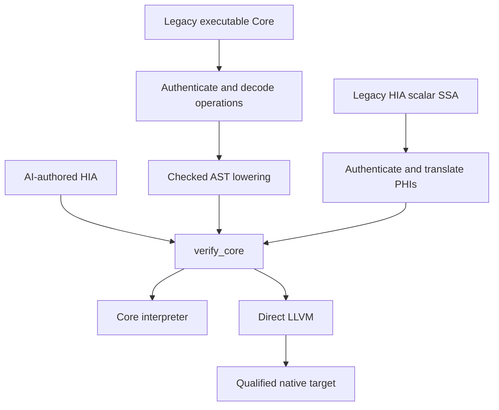

# HIA standalone program v1: normative executable profile

This document defines the standalone `hepta.hia.program.v1` profile. Its
executable admission authority is `hepta.hia_program.verify_core` (also exposed
as `hepta.core.verify_core` and `verify_program`). The direct interpreter and
LLVM backend consume the same immutable, reverified program bytes. No original
Hepta, C, C++, Rust or assembly source is required to admit or execute this
program. A caller-provided hash, proof claim or producer receipt grants no
additional permission.

This is a typed, resource-aware assembly/IR for agent editing. It deliberately
retains explicit values, control-flow edges, calls and resource instructions;
it does not ask a model to infer invisible ownership from machine addresses.
The accepted profile is finite. It is not a proof of full Rust soundness,
arbitrary C/C++ equivalence, or optimal machine code.

## One executable authority, explicit frontends



`hepta.core.from_executable_core` first checks the old source-bound envelope,
decodes its actual executable operations and lowers the decoded, checked AST.
`hepta.core.from_scalar_core` first authenticates the old SSA envelope, then
translates its actual instructions, predecessor-selected PHIs and edges. A
backwards liveness pass makes every cross-block input explicit. It never
substitutes default zero values for unavailable predecessor data. The old
resource gate is preserved during import; new ownership and loan rules then
check the executable result itself.

`hia_program_source.lower_source` is a frontend. Source inference and
source-level `semantic_ir.py` remain relevant to that frontend and to the
broader historical Rust/C paths. They do not become authorities for a submitted
standalone HIA program. The old commands remain compatibility paths with their
original documented scopes. Unsupported source constructs must reject during
lowering; their existence in the Rust reference frontend does not enable them
in this core.

## Wire format and immutable identity

Programs use UTF-8 JSON. Whitespace and key order are accepted on input; the
verified snapshot canonicalizes keys and separators. Duplicate object keys,
nonfinite values, floating JSON numbers, invalid identifiers, unknown fields
and unsupported schemas reject. Limits include 8 MiB encoded input, nesting
depth 64, 262,144 structural nodes, 1,024 functions and 4,096 blocks per function.

The complete top-level shape is:

```json
{"schema":"hepta.hia.program.v1","module":"example","functions":[]}
```

The example above illustrates fields only: a real program must have at least
one function. A function has exactly `name`, `params`, `returns`, `effects`,
`entry`, and `blocks`. A parameter is `{"name":"value","type":"u32"}`.
`returns` is an ordered list of types, including an empty list for no result.
Each block has exactly `id`, `params`, `ops`, and `term`.

Every instruction has exactly:

```json
{"op":"int.add.checked","args":["x","one"],
 "out":[{"name":"answer","type":"u32"}],"attrs":{}}
```

Identifiers are bounded ASCII letters/digits/underscores with a non-digit
first character. `__hia_` is reserved, and runtime symbol collisions such as
`calloc`, `free`, and `abort` cannot be function names. The verifier rejects
duplicate SSA definitions across the whole function, including block inputs.

`VerifiedProgram` holds immutable canonical bytes. Public construction of that
Python dataclass is possible and is not a trust boundary: inspection,
interpretation, emission and native compilation reverify its exact content.
`as_dict()` returns a detached copy. SHA-256 identifies bytes, not truth,
authorship, equivalence or authorization.

## Values, blocks and effects

| Component | v1 semantics |
| --- | --- |
| Integer values | Signed and unsigned 8/16/32/64-bit integers; `isize`/`usize` are fixed at 64 bits |
| Other scalar values | `bool`, `unit`; unit's JSON constant is `null` |
| Resource values | `buffer`, `readbuf`, `mutbuf` |
| Block visibility | Only explicit block parameters and earlier local instructions are visible |
| Entry | Entry parameters exactly equal the function signature; incoming entry edges reject |
| Edges | Exact argument count/types; every live local owner and loan travels or is consumed |
| Branches | Exclusive alternatives; each edge checked independently |
| Joins/loops | Normalized ownership/loan origin/parent/permission state must agree for all predecessors |
| Effects | `alloc`, `read`, `write`, `trap`; every operation and callee effect must be covered |
| Calls | Statically named module functions; no foreign calls or indirect function pointers |
| Reachability | Every declared block must be statically reachable; unreachable payloads reject |

Extra declared effects are allowed; missing required effects reject. Recursion
is permitted in the core and is not a proof of termination or stack bounds.
The interpreter has an independent depth limit. A native caller must provide
ordinary platform stack resources.

### Scalar instruction set

| Instructions | Rules |
| --- | --- |
| `const` | One exactly typed scalar output; attributes contain only `value` |
| `int.add/sub/mul.checked` | Equal integer types; overflow aborts |
| `int.add/sub/mul.wrap` | Equal integer types; modulo word width |
| `int.div/rem.checked` | Division truncates toward zero; divisor zero and signed minimum divided by -1 abort |
| `int.shl/shr.checked` | Shift count must be in `[0,width)`; left shift wraps discarded bits; signed right shift is arithmetic |
| `int.neg.checked` | Result must fit the output integer type |
| `bit.and/or/xor/not` | Fixed-width bit operations |
| `compare.eq/ne/lt/le/gt/ge` | Equal integer types; equality/inequality also admit booleans |
| `bool.not/and/or` | Boolean values; both argument values already exist, so these are not source short-circuit expressions |
| `int.cast` | Attribute `mode` is `checked` or `wrap`; checked range violation aborts |
| `select` | Boolean condition and two equal scalar types; cannot duplicate/select owners |
| `call` | Attribute `function` names a checked function; outputs exactly match all return types |

Source short-circuit Boolean operators lower to branches. In particular the
unselected side of a source `||` is not eagerly executed by `bool.or`.

### Terminators

```json
{"op":"ret","values":["answer"]}
{"op":"jump","target":"loop","args":["next"]}
{"op":"branch","cond":"condition",
 "then":{"target":"yes","args":[]},"else":{"target":"no","args":[]}}
{"op":"trap","code":"bounds"}
```

Trap codes are `user`, `overflow`, `division_by_zero`, `bounds`, `allocation`.
Native traps abort the process. No destructor cleanup after an abort is
promised. Normal return, including errors represented as returned values,
must consume or explicitly return every owned capability and end local loans.

## Resource semantics

`buffer` is a linear owner of initialized bytes. An empty owner is still a
capability and must be consumed exactly once. Native runtime metadata is a
pointer and length; it is private to the implementation and is not an external
safe C aggregate API.

| Instruction | Resource transition and dynamic behavior |
| --- | --- |
| `buffer.new(size)` | Creates one zeroed byte owner; allocation refusal aborts |
| `buffer.try_new(size)` | Returns `(buffer,bool)`; refusal returns an empty owner and false |
| `buffer.len(value)` | Reads a buffer/view's length without copying ownership |
| `borrow.read(value)` | Creates a shared child view; conflicting mutable loans reject |
| `borrow.mut(value)` | Creates an exclusive child view from an owner/mutable view; aliases reject |
| `loan.end(view)` | Ends a locally created view after its child loans have ended |
| `owner.move(owner)` | Consumes the old name and creates a new owner name; outstanding loans reject |
| `owner.drop(owner)` | Consumes/free the owner; outstanding loans reject |
| `buffer.load(view,index)` | Requires read/mutable access; checks index before loading an initialized byte |
| `buffer.store(view,index,byte)` | Requires mutable access; checks index before writing |

Zero-size allocation succeeds without invoking the allocator. Sizes above
`2^63-1` are rejected by the 64-bit object-size model before allocation.
`try_new` maps that rejection to `(empty,false)`. Any other allocator refusal
also yields `(empty,false)` for `try_new`; `new` aborts. Empty-owner drop may
invoke `free(NULL)`, which performs no allocation/deallocation event.

Allocation/refusal and release are observable core effects. The LLVM backend
preserves calls through declaration-level `"no-builtins"` plus call-site
`nobuiltin`; merely applying the call-site marker did not preserve events under
the measured LLVM optimizer. Native evidence separately intercepts allocator
calls and NULL returns, including a missing-free machine-code negative control.

Loans carry a root owner or external borrowed parameter and a parent loan.
Reborrowing suspends use of the parent until the child ends. A view can cross
blocks and loop iterations only with its root and parent capability. Incoming
loan graphs must normalize to the same graph at a join. This supports local
stored capabilities in the executable CFG; it does not enable arbitrary
source-level lifetime records, self-referential objects or escaping borrows.

Owned call arguments are consumed. Borrowed call arguments remain with the
caller and last for that call. A callee cannot end its caller's loan or return
borrowed parameters. Aliased exclusive arguments reject. Owned results may
return; returning an owner with outstanding loans rejects. Multiple internal
results are permitted.

## Frontend representations and current exclusions

Concrete source records are scalarized into an ordered collection of scalar
and owned leaves. A concrete `Result<A,B>` becomes a Boolean tag and both
payload layouts. An inactive owned payload is a real empty owner which the
lowering consumes on the selected match path. This avoids hidden pointer
tagging and unchecked union access; it is an internal representation, not a
promise of C/Rust/C++ enum ABI compatibility.

The source frontend implements finite, closed specialization of generic
functions and records. It first checks the original AST, discovers concrete
instances from actual calls and record types, constructs concrete AST nodes,
checks them again and lowers them to this same core. It generates no source
text for reparsing. The `Copy` and `Owned` constraints therefore resolve to
concrete scalar, record, byte-owner or `Result` layouts; no unchecked generic
form enters the executable schema. `source_report` lists the instantiated
functions/records and distinguishes templates with no concrete use.

Specialization has a combined 128-instance function/record budget and a
32-level concrete type-depth limit. Same-type recursive calls reuse one
instance. Recursion that continually grows its type arguments rejects when a
budget is reached. These finite checks establish no theorem about all possible
future substitutions or termination of the resulting program.

Immediate borrowed-return helpers have a narrower rule: the body must be one
explicit `return read ...` or `return mut ...` projection of an incoming
borrowed parameter or its record fields. The adapter inlines that projection
as checked borrow/reborrow operations and ends local loans after their use;
reading a Copy field produces an independent scalar value. It does not emit
an escaping loan as a function result or enable stored source references.

The exact source frontend scope is recorded by its rejection tests and the
current qualification report. Arbitrary nominal enums/ADTs, custom destructors,
stored/returned lifetimes, asynchronous tasks, cancellation, channels, FFI,
inline assembly, atomics, MMIO, floats and 32-bit word models remain excluded.
Their existence in a broader historical backend does not enable them in this
standalone core.

## Interpreter, native code and external conditions

`execute_program` admits scalar arguments and scalar return values at its
external entry; resources can be created and passed within the program.
Outcomes are `returned`, `trapped`, and `budget_exceeded`. The last two carry
reports via distinct exception classes; the CLI prints the reports as JSON
and exits nonzero. A step, heap or call-depth budget is an evaluator limit,
not a language allocation failure or proof of nontermination. Counters report
the state at the stop and do not invent cleanup after an aborted computation.

The native backend exposes only functions with integer/Boolean parameters and
at most one scalar result as external C wrappers; a unit result maps to void,
and a unit parameter is not exported. Owned/borrowed parameters and
multi-result functions are internal LLVM functions. Small signed/unsigned
integer and Boolean ABI extension rules are target-specific. Cross-target
object generation, emulator execution and physical hardware acceptance are
separate qualifications; a host success cannot qualify a new target.

The current emitter admits `x86_64-unknown-linux-gnu` shared libraries/objects
and `aarch64-unknown-linux-gnu` objects. AArch64 shared-library builds reject.
Its explicit finite execution gate links the independently emitted object to
a reviewed 4096-byte, one-live-allocation runtime and executes it with the
pinned QEMU user-mode binary. That runtime's abort exits with code 134; the
host libc abort controls instead observe SIGABRT. Neither result is a physical
board, DMA, interrupt, GPU or device-timing qualification. The separate
Cortex-M4 reference/BSP gate continues to use the historical Rust path and is
not evidence that standalone HIA supports a 32-bit word model or MMIO.

Native publication regenerates the expected LLVM from the exact reverified
core and target and compares it with the proposed IR. Rehashing changed LLVM
does not admit it. Compiler invocation, output capture and artifact reads are
bounded; artifact symbol/ELF inventories and actual tool digests are recorded.
Publication creates a new file without replacing an existing path.

| Layer | What is established | What remains outside it |
| --- | --- | --- |
| Static checker | Typed closed SSA, complete local linear flows, nonconflicting loan graph, effect coverage | Whole-language soundness theorem, frontend/backend refinement theorem |
| Runtime checks | Integer overflow/division/shift/cast guards, byte bounds, fallible allocation | All program logic, termination, performance, operating-system isolation |
| Native qualification | Actual finite outputs, aborts, allocation/refusal/cleanup traces, artifact inventory | Exhaustive input equivalence or all machine/optimizer behaviors |
| External conditions | Allocator must return distinct initialized live regions; free must accept its live allocation or NULL; platform ABI must hold | Arbitrary foreign callers, malicious same-user artifact modification, device protocol correctness |

The compiler and Python checker, LLVM/Clang, the native runtime, libc and the
platform are part of the present trusted implementation. Foreign code has no
privilege to forge a `buffer` in the standalone public ABI. Hash checks and
no-replace publication do not defend against a malicious same-user process
changing executable bytes after acceptance.

## Agent operations and reproducible commands

```sh
python -m hepta hia verify examples/hia_program/counter.hia
python -m hepta hia inspect examples/hia_program/counter.hia
python -m hepta hia run examples/hia_program/counter.hia \
  --function increment --arguments '[40]'
python -m hepta hia build examples/hia_program/counter.hia \
  --clang clang --output /tmp/counter.so
python -m hepta hia patch examples/hia_program/counter.hia \
  --request examples/hia_program/add_two.patch.json --output /tmp/counter-v2.hia
python -m hepta hia lower examples/hia_program/benchmarks.hepta \
  --module hia_benchmarks --output /tmp/kernels.hia
python -m hepta hia lower examples/hia_migration/generic_owners.hepta \
  --module hia_generic_owners --output /tmp/generic-owners.hia
python -m hepta hia run /tmp/generic-owners.hia \
  --function probe --arguments '[7,true]'
python tools/qualify_hia_program.py --clang clang --output /tmp/hia-native.json
python tools/qualify_hia_program_resources.py --output /tmp/hia-resources.json
python -m hepta hia build examples/hia_program/counter.hia --clang clang \
  --target aarch64-unknown-linux-gnu --kind object --output /tmp/counter-aarch64.o
python tools/qualify_hia_program_aarch64.py --clang clang \
  --linker /absolute/path/to/ld.lld --qemu-aarch64 /absolute/path/to/qemu-aarch64-static \
  --output /tmp/hia-aarch64.json
python tools/qualify_hia_program_perf.py --clang clang \
  --rustc /absolute/path/to/rustc --output /tmp/hia-perf.json
```

Legacy envelopes can be imported using `hia import-executable` or
`hia import-scalar`, both with `--source`. Scalar import additionally requires
the exact `--project-sha256`. Those origin checks occur at conversion. The
emitted HIA program subsequently verifies/runs/builds without the source.

`hepta.hia.patch.v1` takes exactly `schema`, `expected_sha256`, and `edits`.
At most 64 edits may add/replace a function, replace an operation by its
function/block/index, or replace a terminator. Duplicate and overlapping edits
reject. The expected digest prevents applying an edit to a different snapshot.
The complete resulting module is reverified, including all callers, effects,
control flow and resource obligations. Changed interfaces are reported.
Successful patch validation establishes static validity, not preservation of
behavior; task-specific independent tests still decide whether an edit is right.

No language productivity advantage follows from this protocol's existence.
Actual model trials must compare task success, wrong-but-valid edits, tokens,
latency, tool/native-validation cost and later maintenance, with missing and
failed attempts retained. Historical scripted fixture qualification and failed
small-model pilots must not be counted as successful agent outcomes.

The integrated frozen-source run is `tools/qualify_hia_unified.py`. It executes
the regression suite, independent native/resource/migration/AArch64 gates,
historical Core/composition/board regression gates and the 63-sample performance
protocol. It retains each command/log, refuses to count skipped tests as a
complete pass, and compares source snapshots before/after. Its
`full_six_deliverables_complete` stays false while the documented general
resource, migration, physical-target and agent-benefit obligations remain open.
