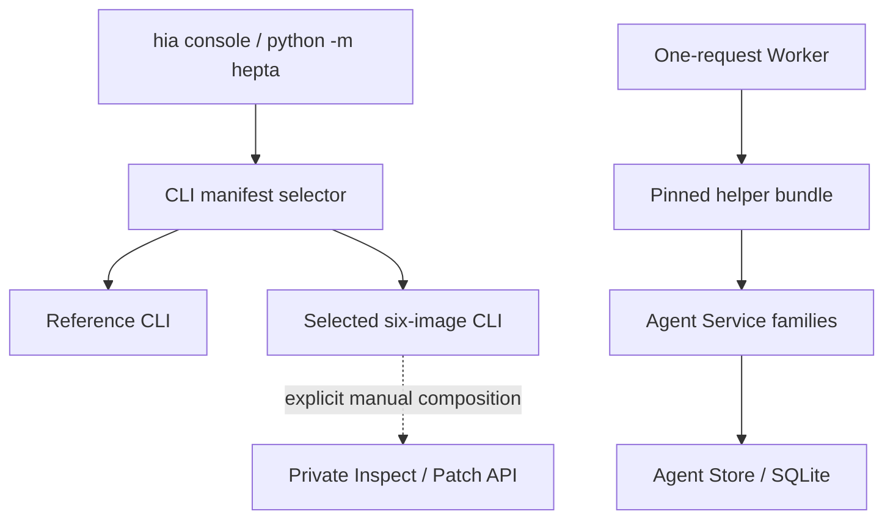

# Current production selection and legacy-retirement dependencies

## Scope

Static reading of `/workspace/hia-cli-as-dict-generation-r1-dda7/source`, the current 3,210-file op8 source whose actual generation identity was reported as tree `7f694b80c7ab76eb9d62402aeea4c331503ddc16`. This is a code-routing review, not a fresh whole-tree readback or deployment observation. No project import, binder, VM, reader, product, or source modification was performed. `SOURCE-PINS.json` binds the specific complete files used for this review.

Surface's frozen `/workspace/hia-cli-as-dict-owner-author-r1-dda7/STORE-NEXT.md` supplies the existing Store transaction analysis. Its separate new head/commit authoring is not counted as generated, connected or qualified here.

## Main finding

The ordinary CLI selector does not activate the new Inspect/Patch adapters. `cli.hia_main` lines 210-215 uses `_reference_hia_main` without `HEPTA_HIA_CLI_MANIFEST`. For a verified-report manifest, `hia_cli_native.installed_cli` lines 681-683 calls the six-image loader, which returns `NativeReportCli`.

The report adapter's op8 and op9 routes are connected on this branch. Inspect and Patch remain additional explicit private interfaces requiring preissued definition records. Private qualification does not establish activation through the ordinary manifest entry.

## Two entrypoints and their actual routes

The `CN → IP` edge is an available explicit API composition; ordinary `installed_cli` does not currently call it. CLI file commands and Worker are separate entrypoints. An external runtime adapter launches Worker and owns the surrounding protocol. Actual external runtime/MCP deployment was not inspected and cannot be inferred from these files.

## Actual owner and remaining dependency map

| Layer / caller | Present selection and HIA owner | Remaining production dependency |
|---|---|---|
| Console | `pyproject.toml` maps `hia` to `hepta.cli:hia_main`; `__main__` calls the same function. | Python startup/imports/argparse and the complete unselected reference CLI remain installed. |
| CLI control and reports | `installed_cli` accepts base, discovery/parser-context or six-image report bundles. `NativeReportCli.prepare` lines 77-107 retains original preparation and intercepts real op8 `invoke_bound_as_dict` and op9 `invoke_bound_report` effects. | Python sessions, captured descriptors, dynamic providers, permission-owned legacy ports and the original effect method remain required. |
| Inspect | `select_inspect_report_cli` requires an issued record, current exact class/method anchors and Import35Port. Private `installed_bundle` lines 135-144 explicitly says it is not in the ordinary selector. | Ordinary manifest loading neither issues a record nor selects this class. Code-object admission, opaque record registry, import witness, foreign providers and continuation services remain hosted. |
| Patch | Private `installed_bundle` lines 126-131 composes Inspect then `select_patch_inspect_cli`; both issued records must share a definition domain. | Ordinary loading does not create these records or select this class. HIA policy and terminal quarantine do not replace every foreign provider or Python object operation. |
| Worker | `main` enters `native_helpers_scope`; `_run` lines 43-49 selects `NativeWorkerReport` only when enabled. Request admission has a separate selector after actual stdin at lines 68-91. | `_reference_run`, stdin/stdout, installation identity, Service construction/cleanup and correlated error reporting remain live Python code. |
| Worker selection authority | `native_helpers_scope` lines 312-359 requires manifest+SHA, rejects ambient selectors/another active scope, admits v1/v2/v3 bundles, installs selections, then restores the complete selector namespace. | Deployment must provide the actual pinned bundle. Packaged images or individual ambient selector variables do not constitute supported Worker activation. Admission and process/thread scope remain hosted. |
| Service families | `HIAAgentService.__init__` lines 89-147 captures Requests, Artifacts, Context, Emission, Verification, Evaluation and Proof owners. Inspected `admitted_*` functions return None when absent; wrappers choose native owner or retained body. | Full reference definitions and provider anchors remain required. Family policy ownership does not replace Core/compiler providers, Store/SQL, clock/UUID/JSON/filesystem providers or Python object semantics. |
| Request transaction | `HIAAgentService.call` lines 354-363 selects statement journal or continuation journal, refuses selecting both, and otherwise calls `_call_reference`. | Request completion and affected tool mutations must retain one atomic commit. Separate immutable-file publication cannot replace this transaction. |
| Store lifecycle | `AgentStore.__init__` captures lifecycle selection before effects. The retained initialization body opens `state.sqlite3`, sets WAL/FULL and creates ten tables. The selected HIA lifecycle also services the actual providers. | `sqlite3.connect`, actual connection/SQL/locks/disk/WAL/COMMIT/ROLLBACK remain foreign. Owning lifecycle control does not implement the database. |
| Store namespace/budget/slots | Initialization captures execution budget, request journal, namespace and slot-ledger. Namespace explicitly requires the native byte owner. Public put/get/profile methods select namespace or reference methods. | Artifact/profile/context/request/cost/cursor/slot/version/lease/budget state remains relational. Incompatible transaction-family combinations are rejected; selecting every image independently is not necessarily coherent. |
| Immutable bytes | `_native_artifact_admission/_native_artifact_file` selects the existing artifact-publication store-hash/store-put/store-get application. | This covers immutable content, not multi-table metadata or atomic request completion. Surface's next Store authoring is a separate ungenerated candidate. |
| Core/compiler | `verify_program` has explicit native Core selection and preserves original full checks as the unselected path. `build_program_machine` selects the native build scope or the retained builder. | Default/public domains, decode/assembly providers, foreign exports, linking and strict original source anchors remain. Restricted checker/fuel or encoding results do not replace all public compiler paths. |
| Execution/reference VM | `run_native_batch` lines 52-183 creates artifacts/snapshots and launches `sys.executable -B -E -s -m hepta.hia_agent_runner`, checks termination, then captures buffers. `run_reference_batch` uses the same owner in reference mode. Public execute imports the Python VM. | Supervision, limits, process groups, library mapping, call ABI, snapshots, JSON and reference VM remain Python/OS responsibilities even when the invoked machine code is HIA-produced. |

## Concrete integration and retirement requirements

1. **Choose the exact entry being switched.** Ordinary CLI, Worker bundle, direct Service construction and external runtime/MCP deployment have separate selection authorities. Each needs its own actual installed route and current identities.
2. **Close the ordinary Inspect/Patch loader gap.** A versioned loader must bind real images/source/host definitions and deliver admitted records while preserving original import/provider timing. Keep the six-image preparation chain and foreign/replaced-provider behavior. An opaque Python issuer remains host authority, not a standalone HIA replacement.
3. **Replace or explicitly retain the foreign effects.** Front/Continuation code still hosts Python objects, callables and exceptions while HIA owns transitions. Current host maps and definition anchors require those original sources. Deleting them now breaks default execution and selected admission.
4. **Complete the Store transaction contract.** Preserve atomic request response plus slot/version/budget changes, restart/replay, concurrent claims and uncertain commit. The immutable artifact application is reusable; a new head codec alone does not implement all ten tables.
5. **Separate production closure from evidence.** Loader/host-map sources and installed resources are production deletion blockers. Test/oracle/audit scripts serve qualification and recovery; counting them as production owners or dropping them cannot establish a native closure. Historical failures retain their identity.
6. **Regenerate actual dependent identities.** The op8 host-source change required real Inspect/Patch generation. Future shared source/loader changes likewise require original generator/check, actual build and installed-resource tests. Generated pins cannot be hand-edited, and old current-cold results cannot be relabelled.

## Narrow next integration slice

After the current Inspect/Patch gates close, the ordinary CLI selection gap is a concrete next task separate from Store and compiler-fuel work: an explicit versioned loader/selection contract that composes the real six-image owner with admitted Inspect/Patch owners. Its qualification must enter through actual `hia_main → installed_cli`, assert the selected class and physical HIA entries, and preserve captured provider/import-witness order, foreign/stale definitions, lost ACK, reentry, independent nesting and finalizer lifetimes.

This is a proposed interface boundary, not an authored change or deployment authorization. It closes selection wiring while leaving the listed issuer/foreign-runtime and SQLite responsibilities explicit.

## Review limits

The named entry/selection functions, complete CLI/Worker route, relevant Store construction/transaction methods and VM/runner boundaries were read. This is not a full Service/Store audit, generic dependency resolver, timing qualification, or external deployment check. Current whole-Native and legacy-deletable status remain false.
